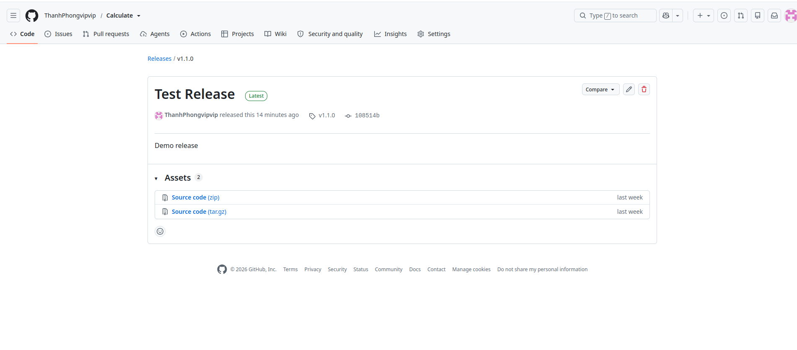

# Git Release

## Mục đích

Release trên GitHub cho phép:
- Đóng gói và phân phối ứng dụng cho người dùng
- Đính kèm ghi chú phát hành, tài liệu và file nhị phân
- Đánh dấu các phiên bản quan trọng trong lịch sử dự án

Release được liên kết với Git tag và được sắp xếp theo thứ tự thời gian tạo.

## Cách tạo Release

### Cách 1: Tạo qua giao diện Web GitHub

#### Bước 1: Tạo Release và Tag

1. Truy cập repository trên GitHub
2. Chọn **Releases** → **Create a new release**
3. Trong trường **Choose a tag**:
   - Nhập tên tag mới (ví dụ: `v1.2.0`)
   - Chọn **Create new tag on publish**
4. Chọn nhánh (branch) để tạo tag
5. Điền thông tin:
   - **Release title**: Tiêu đề bản phát hành
   - **Description**: Mô tả chi tiết các thay đổi
6. Nhấn **Publish release**



#### Bước 2: Cập nhật Tag về Local Repository

Sau khi tạo release trên GitHub, cập nhật tag về máy local:

```bash
cd /path/to/repository
git fetch --tags
git tag
```

**Xem thông tin tag:**
```bash
git show v1.2.0
```

#### Xóa Tag và Release

**Xóa tag trên local:**
```bash
git tag -d v1.2.0
```

**Xóa tag trên remote:**
```bash
git push origin --delete v1.2.0
```

**Xóa Release:** Trên GitHub, vào **Releases** → Chọn release → **Delete** → Xác nhận.

### Cách 2: Tạo qua GitHub CLI (gh)

#### Cài đặt GitHub CLI

```bash
# Cài đặt gh CLI trên Ubuntu/Debian
sudo apt update
sudo apt install gh -y
```

#### Xác thực GitHub

```bash
gh auth login
```

Làm theo hướng dẫn để đăng nhập vào tài khoản GitHub.

#### Tạo Release

```bash
# Tạo release cơ bản
gh release create v1.0.0 --title "Release v1.0.0" --notes "Mô tả chi tiết các thay đổi"

# Tạo release kèm file đính kèm
gh release create v1.0.0 --title "Release v1.0.0" --notes "Mô tả" app.zip

# Tạo draft release (nháp)
gh release create v1.0.0 --draft --title "Draft Release" --notes "Chưa phát hành"

# Tạo pre-release
gh release create v1.0.0-beta --prerelease --title "Beta Release" --notes "Phiên bản thử nghiệm"
```

**Các lệnh hữu ích khác:**

```bash
# Liệt kê các release
gh release list

# Xem chi tiết một release
gh release view v1.0.0

# Xóa release
gh release delete v1.0.0

# Tải về asset từ release
gh release download v1.0.0
```

---

# GitHub Packages

## Giới thiệu

GitHub Packages là dịch vụ lưu trữ gói phần mềm tích hợp với GitHub, cho phép:
- Lưu trữ packages ở chế độ **public** hoặc **private**
- Quản lý phiên bản packages cùng source code
- Tích hợp với CI/CD workflows

- **GitHub Packages**: Chứa **artifacts** (sản phẩm đã build/đóng gói)

## So sánh với các dịch vụ khác

| Loại Package | GitHub Packages | Registry Truyền thống |
|:-------------|:----------------|:----------------------|
| JavaScript   | ✓ npm           | npmjs.com             |
| Java         | ✓ Maven         | Maven Central         |
| Python       | ✓ PyPI          | pypi.org              |
| Docker       | ✓ Container     | Docker Hub            |
| .NET         | ✓ NuGet         | nuget.org             |
| Ruby         | ✓ RubyGems      | rubygems.org          |


**Ví dụ với Docker:**

```bash
# Build Docker 
docker compose build

# Save a single image
docker save -o image_name.tar repository:tag

docker images 

# Đăng nhập vào GHCR
export CR_PAT='YOUR_TOKEN'
echo "$CR_PAT" | docker login ghcr.io -u YOUR_USERNAME --password-stdin

# Tag image với GitHub Container Registry
docker tag repository:tag \
  ghcr.io/USERNAME/repository:tag

# Push image lên GitHub Packages
docker push ghcr.io/USERNAME/repository:tag
```

```bash 
# Pull image
docker pull ghcr.io/USERNAME/repository:tag
```

---


# GitHub Projects

## Mục đích

GitHub Projects là công cụ quản lý dự án tích hợp với GitHub, giúp:
- Tổ chức và theo dõi công việc
- Quản lý Issues và Pull Requests
- Hiển thị tiến độ dự án theo phong cách Kanban hoặc Table

## Cấu trúc Repository với Projects

```
Repository: DisplayInfo
│
├── Code             → Mã nguồn
├── Issues           → Các task, bug cần làm
├── Pull Requests    → Code reviews
└── Projects         → Bảng quản lý công việc
```

## Ví dụ: Quản lý App ABC

### Danh sách công việc và trạng thái

| Công Việc        | Trạng thái  |
|:-----------------|:------------|
| Thiết kế GUI     | Done        |
| Chức năng A      | In Progress |
| Fix bug #12      | To Do       |
| Unit test        | To Do       |

### Bảng Kanban trong Project

| 📝 To Do         | 🔄 In Progress      | ✅ Done         |
|:----------------|:-------------------|:----------------|
| Fix bug #12     | Implement UI       | Setup project   |
| Write tests     | API connection     | Database schema |
| Fix display     |                    |                 |

## Quy trình làm việc

### 1. Tạo Issue

```
Issue #12: Fix Display Bug
- Mô tả: Màn hình hiển thị sai khi resize
- Labels: bug, UI
- Assignee: @dev-team
```

### 2. Thêm Issue vào Project

Kéo Issue #12 vào cột **To Do** của Project Board

### 3. Theo dõi tiến độ

```
Issue #12 (Fix Display)
   ↓
[To Do] → Chưa bắt đầu
   ↓
[In Progress] → Đang làm
   ↓
[Done] → Hoàn thành
```

### 4. Liên kết với Pull Request

```
Pull Request #15: Fix display bug (close #12)
```

Khi PR được merge, Issue #12 tự động chuyển sang Done.

## Phân biệt

- **Repository/Code**: Chứa source code thực tế
- **Issues**: Danh sách công việc, bug, feature request
- **Projects**: Công cụ **quản lý và visualize** các Issues

## Tạo Project qua CLI

```bash
# Cài đặt gh nếu chưa có
sudo apt install gh

# Tạo project mới
gh project create --title "Sprint 1" --owner username

# Liệt kê projects
gh project list

# Thêm issue vào project
gh project item-add PROJECT_NUMBER --owner username --url ISSUE_URL
```

## Lưu ý

- Project giúp **tổ chức công việc**, không thay thế Git workflow
- Có thể tạo nhiều Projects cho các mục đích khác nhau (Sprint, Roadmap, Bug Tracking)
- Hỗ trợ automation: tự động chuyển trạng thái khi PR được merge

