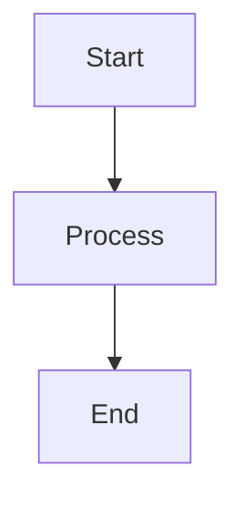

# Markdown - Viết Biểu Thức Toán Học (LaTeX Math)

## Giới thiệu

Markdown hỗ trợ viết công thức toán học bằng cú pháp LaTeX, được hiển thị trong các nền tảng như GitHub, Jupyter, VS Code, v.v.

## Cú pháp cơ bản

- **Inline math** (trong dòng): `$...$` hoặc `\(...\)`
- **Display math** (độc lập): `$$...$$` hoặc `\[...\]`

**Ví dụ:**
```markdown
Công thức Euler: $e^{i\pi} + 1 = 0$

Phương trình độc lập:
$$E = mc^2$$
```

---

## Bảng ký hiệu toán học thường dùng

### Ký hiệu cơ bản

| Ký hiệu | LaTeX | Mô tả |
|:--------|:------|:------|
| $\to$ | `\to` | Mũi tên (đến) |
| $\infty$ | `\infty` | Vô cùng |
| $\pm$ | `\pm` | Cộng trừ |
| $\times$ | `\times` | Nhân |
| $\div$ | `\div` | Chia |
| $\ne$ hoặc $\neq$ | `\ne` hoặc `\neq` | Không bằng |
| $\approx$ | `\approx` | Xấp xỉ |
| $\equiv$ | `\equiv` | Đồng nhất |

### Chỉ số trên và dưới

| Ký hiệu | LaTeX | Giải thích |
|:--------|:------|:-----------|
| $k_{n+1}$ | `k_{n+1}` | Chỉ số dưới (subscript) |
| $n^2$ | `n^2` | Chỉ số trên (superscript) |
| $k_n^2$ | `k_n^2` | Kết hợp cả hai |
| $x_1^2 + x_2^2$ | `x_1^2 + x_2^2` | Nhiều biến |

**Lưu ý:** Dùng `{}` cho nhóm ký tự:
- `k_n+1` → $k_n+1$ (chỉ n là subscript)
- `k_{n+1}` → $k_{n+1}$ (cả n+1 là subscript)

### Phân số

| Ký hiệu | LaTeX | Mô tả |
|:--------|:------|:------|
| $\frac{a}{b}$ | `\frac{a}{b}` | Phân số chuẩn |
| $\frac{n!}{k!(n-k)!}$ | `\frac{n!}{k!(n-k)!}` | Phân số phức tạp |
| $\binom{n}{k}$ | `\binom{n}{k}` | Tổ hợp (binomial) |
| $\frac{\frac{x}{a}}{x-a}$ | `\frac{\frac{x}{a}}{x-a}` | Phân số lồng nhau |
| $^3/_7$ | `^3/_7` | Phân số inline đơn giản |

### Căn bậc

| Ký hiệu | LaTeX |
|:--------|:------|
| $\sqrt{k}$ | `\sqrt{k}` |
| $\sqrt[3]{k}$ | `\sqrt[3]{k}` |
| $\sqrt[n]{k}$ | `\sqrt[n]{k}` |

### Tổng, tích phân, tích

| Ký hiệu | LaTeX | Mô tả |
|:--------|:------|:------|
| $\sum_{i=1}^{10} t_i$ | `\sum_{i=1}^{10} t_i` | Tổng |
| $\prod_{i=1}^{n} x_i$ | `\prod_{i=1}^{n} x_i` | Tích |
| $\int_0^\infty e^{-x} dx$ | `\int_0^\infty e^{-x} dx` | Tích phân |
| $\int_{-\infty}^{\infty}$ | `\int_{-\infty}^{\infty}` | Tích phân vô hạn |
| $\iint$ | `\iint` | Tích phân kép |
| $\iiint$ | `\iiint` | Tích phân bội ba |

### Chữ Hy Lạp (Greek Letters)

| Chữ thường | LaTeX | Chữ hoa | LaTeX |
|:-----------|:------|:--------|:------|
| $\alpha$ | `\alpha` | $\Alpha$ | `\Alpha` |
| $\beta$ | `\beta` | $\Beta$ | `\Beta` |
| $\gamma$ | `\gamma` | $\Gamma$ | `\Gamma` |
| $\delta$ | `\delta` | $\Delta$ | `\Delta` |
| $\epsilon$ | `\epsilon` | $\Epsilon$ | `\Epsilon` |
| $\theta$ | `\theta` | $\Theta$ | `\Theta` |
| $\lambda$ | `\lambda` | $\Lambda$ | `\Lambda` |
| $\pi$ | `\pi` | $\Pi$ | `\Pi` |
| $\phi$ | `\phi` | $\Phi$ | `\Phi` |
| $\sigma$ | `\sigma` | $\Sigma$ | `\Sigma` |
| $\omega$ | `\omega` | $\Omega$ | `\Omega` |

**Biến thể:**
- $\varphi$ (`\varphi`) - Phi biến thể
- $\varepsilon$ (`\varepsilon`) - Epsilon biến thể

### Ký hiệu đặc biệt

| Ký hiệu | LaTeX | Ý nghĩa |
|:--------|:------|:--------|
| $\hat{a}$ | `\hat{a}` | Ước lượng (estimate) |
| $\bar{x}$ | `\bar{x}` | Trung bình |
| $\dot{x}$ | `\dot{x}` | Đạo hàm theo thời gian |
| $\vec{v}$ | `\vec{v}` | Vector |
| $\overrightarrow{AB}$ | `\overrightarrow{AB}` | Vector từ A đến B |

### Ma trận

```latex
$\begin{bmatrix} 
1 & 2 & 3 \\ 
4 & 5 & 6 \\ 
7 & 8 & 9 
\end{bmatrix}$
```

**Kết quả:**

$\begin{bmatrix} 1 & 2 & 3 \\ 4 & 5 & 6 \\ 7 & 8 & 9 \end{bmatrix}$

**Các loại ma trận:**
- `bmatrix` - Ngoặc vuông [ ]
- `pmatrix` - Ngoặc tròn ( )
- `vmatrix` - Dấu trị tuyệt đối | |
- `Vmatrix` - Dấu trị tuyệt đối kép || ||

### Toán tử và logic

| Ký hiệu | LaTeX | Ý nghĩa |
|:--------|:------|:--------|
| $\le$ hoặc $\leq$ | `\le` hoặc `\leq` | Nhỏ hơn hoặc bằng |
| $\ge$ hoặc $\geq$ | `\ge` hoặc `\geq` | Lớn hơn hoặc bằng |
| $\neq$ | `\neq` | Không bằng |
| $\approx$ | `\approx` | Xấp xỉ |
| $\sim$ | `\sim` | Tương tự |
| $\equiv$ | `\equiv` | Tương đương |
| $\Rightarrow$ | `\Rightarrow` | Kéo theo (→) |
| $\Leftrightarrow$ | `\Leftrightarrow` | Tương đương (⇔) |
| $\in$ | `\in` | Thuộc |
| $\notin$ | `\notin` | Không thuộc |
| $\subset$ | `\subset` | Tập con |
| $\subseteq$ | `\subseteq` | Tập con hoặc bằng |
| $\cup$ | `\cup` | Hợp |
| $\cap$ | `\cap` | Giao |
| $\forall$ | `\forall` | Với mọi (for all) |
| $\exists$ | `\exists` | Tồn tại (exists) |

### Hàm và toán tử đặc biệt

| Ký hiệu | LaTeX | Ý nghĩa |
|:--------|:------|:--------|
| $\arg\min_{x} f(x)$ | `\arg\min_{x} f(x)` | Argmin |
| $\arg\max_{x} f(x)$ | `\arg\max_{x} f(x)` | Argmax |
| $\lim_{x \to \infty}$ | `\lim_{x \to \infty}` | Giới hạn |
| $\log$ | `\log` | Logarit |
| $\ln$ | `\ln` | Logarit tự nhiên |
| $\sin, \cos, \tan$ | `\sin, \cos, \tan` | Hàm lượng giác |

---

## Ví dụ nâng cao

### Công thức phức tạp

```latex
$$
f(x) = \frac{1}{\sigma\sqrt{2\pi}} e^{-\frac{(x-\mu)^2}{2\sigma^2}}
$$
```

**Kết quả:**
$$f(x) = \frac{1}{\sigma\sqrt{2\pi}} e^{-\frac{(x-\mu)^2}{2\sigma^2}}$$

### Hệ phương trình

```latex
$$
\begin{cases}
x + y = 5 \\
2x - y = 1
\end{cases}
$$
```

**Kết quả:**
$$\begin{cases} x + y = 5 \\ 2x - y = 1 \end{cases}$$

### Căn chỉnh nhiều dòng

```latex
$$
\begin{align}
f(x) &= (x+1)^2 \\
     &= x^2 + 2x + 1
\end{align}
$$
```

---

## Lưu ý quan trọng

1. **Chỉ số dưới/trên:** Dùng `_` cho subscript, `^` cho superscript
2. **Nhóm ký tự:** Dùng `{}` để nhóm nhiều ký tự: `x_{n+1}` không phải `x_n+1`
3. **Khoảng trắng:** LaTeX tự động xử lý spacing, dùng `\,` cho khoảng nhỏ, `\quad` cho khoảng lớn
4. **Hàm:** Dùng `\sin`, `\cos`, không phải `sin`, `cos` để có định dạng đúng
5. **Ngoặc lớn:** Dùng `\left(` và `\right)` để tự động scale: `\left( \frac{a}{b} \right)`

---

## Tích hợp với Mermaid

Bạn có thể kết hợp Math với Mermaid diagrams:

```markdown
<div align="center">

$$E = mc^2$$

\`\`\`mermaid
flowchart LR
    A[Input] --> B[Process]
    B --> C[Output: E = mc²]
\`\`\`

</div>
```

<div align="center">



</div>