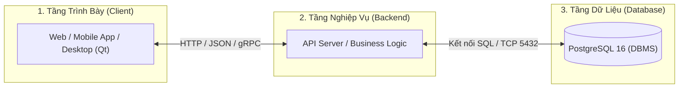
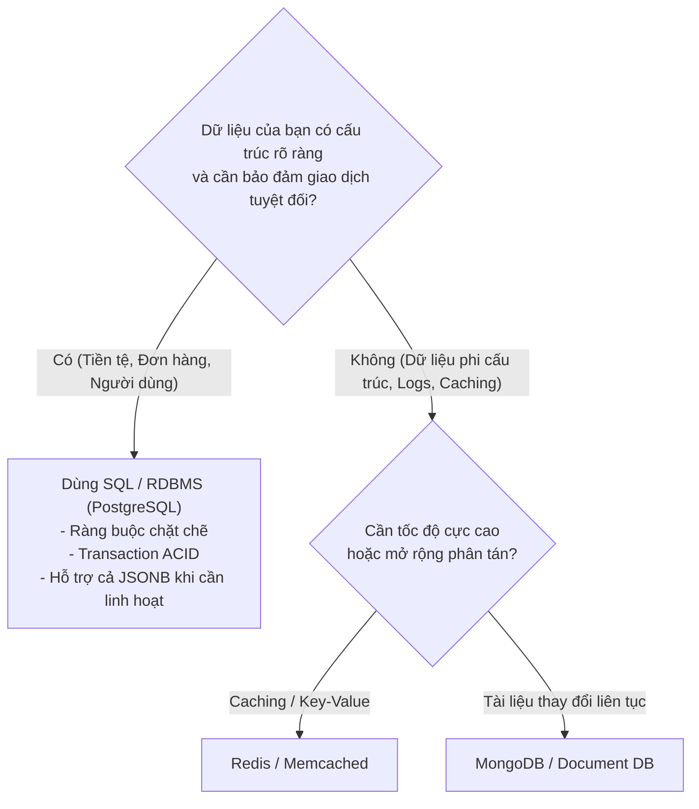
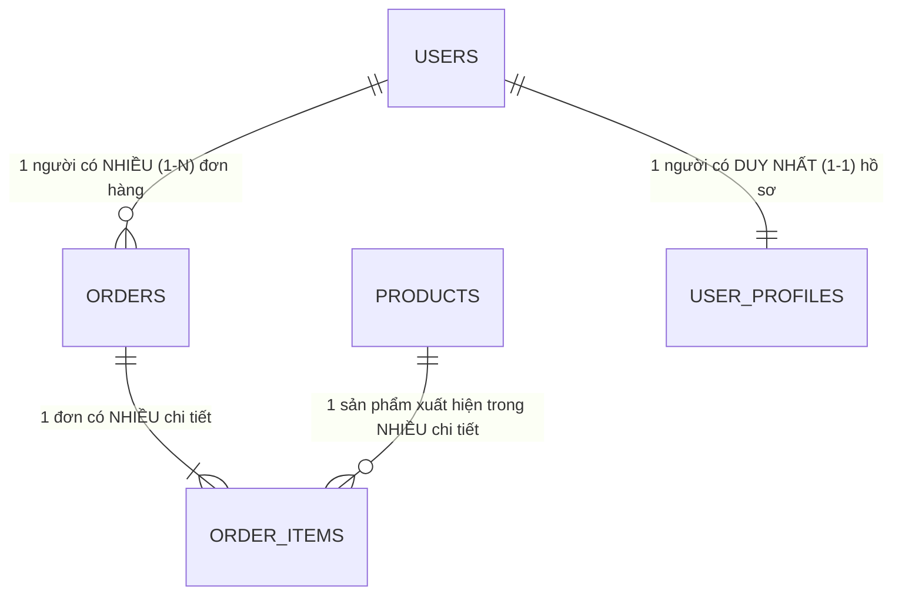
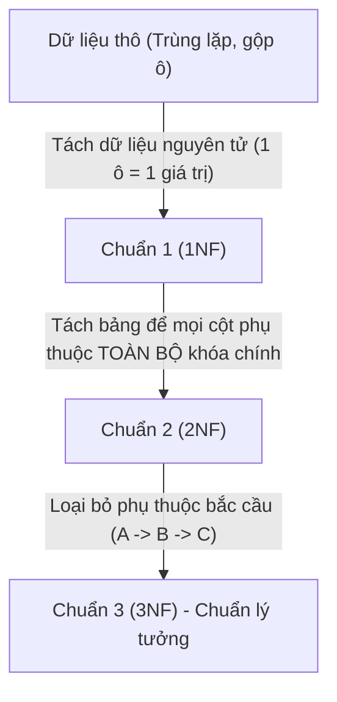
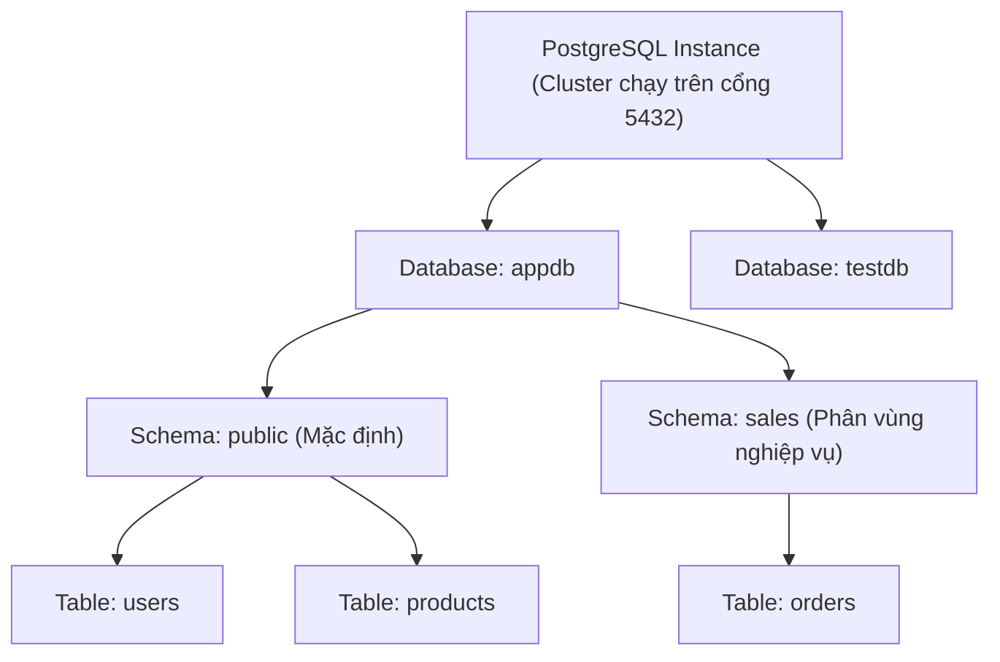
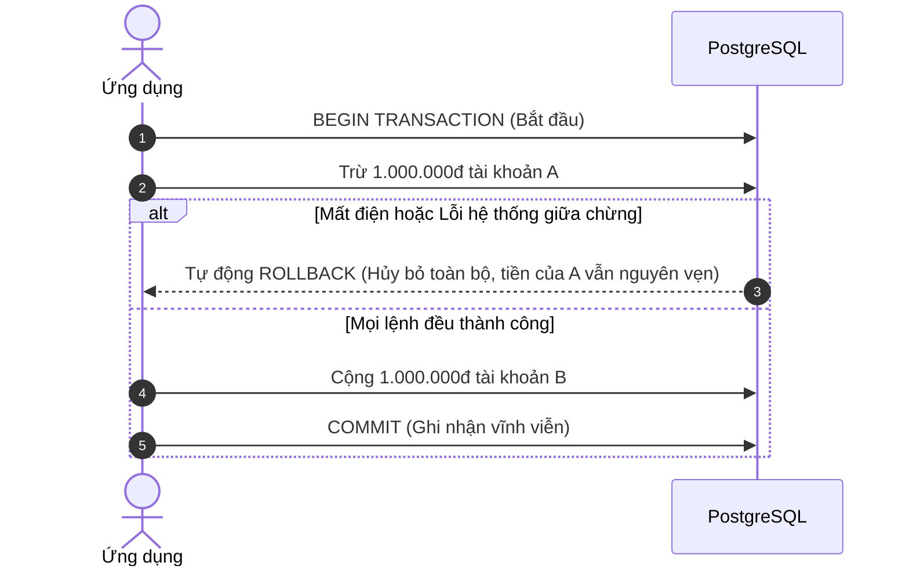
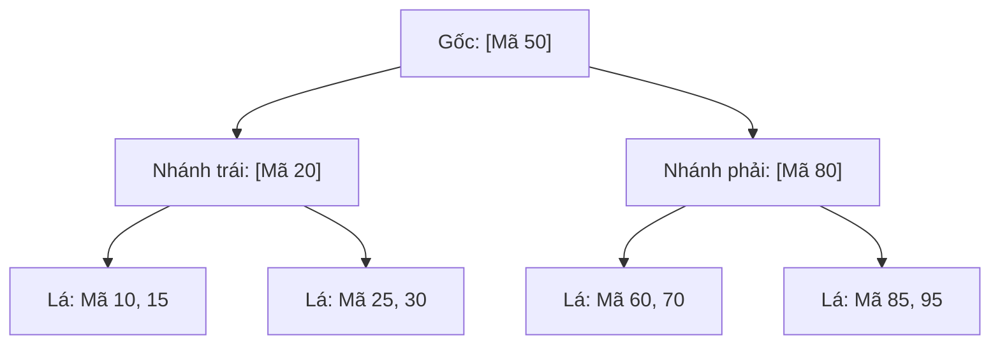
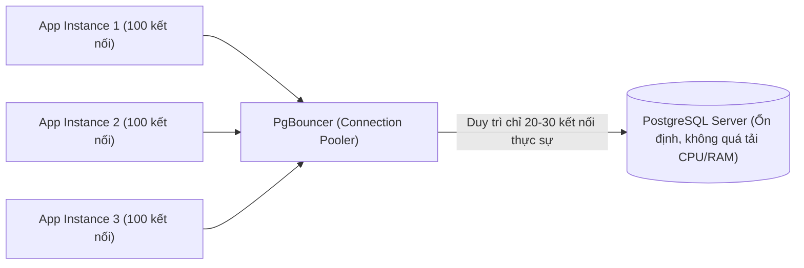
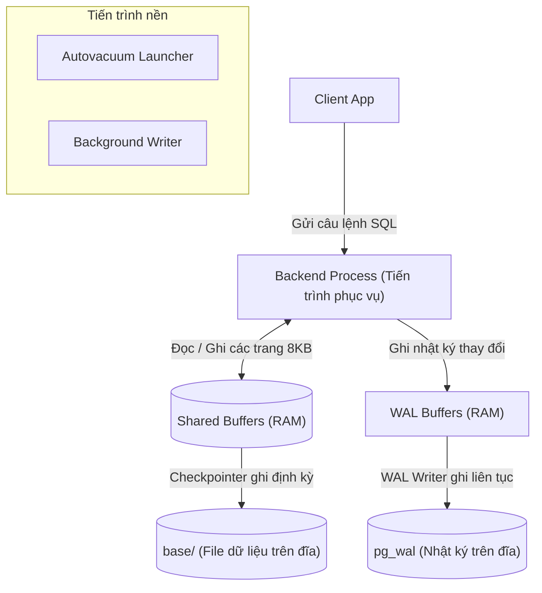

# Sổ Tay Toàn Diện Cơ Sở Dữ Liệu & PostgreSQL 16 (Trực Quan & Dễ Hiểu)

Tài liệu được biên soạn lại theo hướng **dễ tiếp cận, thực tế và trực quan nhất**: mọi khái niệm đều có sơ đồ hoặc ví dụ minh họa, toàn bộ các câu lệnh truy vấn SQL được tổng hợp thành **bảng tra cứu có hình ảnh minh họa kết quả**, kèm phần chuyên sâu về **tối ưu hiệu năng truy vấn** trong PostgreSQL 16.

> Ứng dụng demo thực tế Qt + PostgreSQL 16 + Docker: xem tại thư mục [`qt-postgres-login-demo/`](qt-postgres-login-demo/README.md).

---

## Mục lục

1. [Phần 1: Nhập môn Cơ Sở Dữ Liệu & Mô Hình Quan Hệ](#phần-1-nhập-môn-cơ-sở-dữ-liệu--mô-hình-quan-hệ)
   - [1.1 CSDL là gì? Tại sao không dùng Excel/File?](#11-csdl-là-gì-tại-sao-không-dùng-excelfile)
   - [1.2 SQL (Quan hệ) vs NoSQL: Khi nào dùng gì?](#12-sql-quan-hệ-vs-nosql-khi-nào-dùng-gì)
   - [1.3 Các khái niệm cốt lõi: Bảng, Cột, Hàng, Khóa, NULL](#13-các-khái-niệm-cốt-lõi-bảng-cột-hàng-khóa-null)
   - [1.4 Các mối quan hệ (1-1, 1-N, N-N)](#14-các-mối-quan-hệ-1-1-1-n-n-n)
   - [1.5 Chuẩn hóa dữ liệu (1NF -> 2NF -> 3NF) cực dễ hiểu](#15-chuẩn-hóa-dữ-liệu-1nf---2nf---3nf-cực-dễ-hiểu)
2. [Phần 2: PostgreSQL 16 & Cài Đặt Bằng Docker](#phần-2-postgresql-16--cài-đặt-bằng-docker)
   - [2.2 Chạy PostgreSQL 16 + pgAdmin bằng Docker Compose](#22-chạy-postgresql-16--pgadmin-bằng-docker-compose)
   - [2.3 Bảng lệnh tắt psql bỏ túi](#23-bảng-lệnh-tắt-psql-bỏ-túi)
   - [2.4 Cấu trúc tổ chức: Cluster -> Database -> Schema -> Table](#24-cấu-trúc-tổ-chức-cluster---database---schema---table)
3. [Phần 3: Bảng Tra Cứu Toàn Diện Các Câu Lệnh Truy Vấn SQL (Kèm Ví Dụ & Minh Họa)](#phần-3-bảng-tra-cứu-toàn-diện-các-câu-lệnh-truy-vấn-sql)
   - [3.1 Bảng lệnh tạo và sửa cấu trúc (DDL)](#31-bảng-lệnh-tạo-và-sửa-cấu-trúc-ddl)
   - [3.2 Bảng lệnh thao tác dữ liệu cơ bản (DML)](#32-bảng-lệnh-thao-tác-dữ-liệu-cơ-bản-dml)
   - [3.3 Bảng điều kiện lọc & Tìm kiếm (WHERE, LIKE, IN, BETWEEN...)](#33-bảng-điều-kiện-lọc--tìm-kiếm)
   - [3.4 Bảng hàm tổng hợp & Gom nhóm (GROUP BY, HAVING)](#34-bảng-hàm-tổng-hợp--gom-nhóm)
   - [3.5 BẢNG CÁC PHÉP JOIN (Có hình ảnh minh họa Venn & Kết quả)](#35-bảng-các-phép-join-có-hình-ảnh-minh-họa)
   - [3.6 Bảng truy vấn nâng cao (Subquery, CTE, UPSERT, Set Operations)](#36-bảng-truy-vấn-nâng-cao)
   - [3.7 Bảng Window Function & JSONB (Báo cáo & Dữ liệu động)](#37-bảng-window-function--jsonb)
4. [Phần 4: Bản Chất Transaction, Khóa & MVCC](#phần-4-bản-chất-transaction-khóa--mvcc)
   - [4.1 ACID là gì?](#41-acid-là-gì)
   - [4.2 MVCC: Tại sao đọc không chặn ghi, ghi không chặn đọc?](#42-mvcc-tại-sao-đọc-không-chặn-ghi-ghi-không-chặn-đọc)
   - [4.3 Các mức cô lập (Isolation Levels) & Hiện tượng đọc sai](#43-các-mức-cô-lập-isolation-levels--hiện-tượng-đọc-sai)
   - [4.4 Khóa hàng: FOR UPDATE & FOR UPDATE SKIP LOCKED](#44-khóa-hàng-for-update--for-update-skip-locked)
5. [Phần 5: Nghệ Thuật Tối Ưu Hóa Truy Vấn (Query Optimization)](#phần-5-nghệ-thuật-tối-ưu-hóa-truy-vấn-query-optimization)
   - [5.1 Chỉ mục (Index) hoạt động thế nào? (B-Tree vs Seq Scan)](#51-chỉ-mục-index-hoạt-động-thế-nào)
   - [5.2 Bảng tra cứu các loại Index trong PostgreSQL](#52-bảng-tra-cứu-các-loại-index-trong-postgresql)
   - [5.3 Hướng dẫn đọc EXPLAIN (ANALYZE, BUFFERS)](#53-hướng-dẫn-đọc-explain-analyze-buffers)
   - [5.4 Bảng so sánh "NÊN LÀM vs NÊN TRÁNH" khi viết SQL](#54-bảng-so-sánh-nên-làm-vs-nên-tránh-khi-viết-sql)
   - [5.5 VACUUM, Autovacuum & Xử lý phình dữ liệu (Bloat)](#55-vacuum-autovacuum--xử-lý-phình-dữ-liệu-bloat)
   - [5.6 Tối ưu cấu hình RAM/Disk & Connection Pooling (PgBouncer)](#56-tối-ưu-cấu-hình-ramdisk--connection-pooling-pgbouncer)
6. [Phần 6: Kiến Trúc Nội Bộ, Bảo Mật & Backup](#phần-6-kiến-trúc-nội-bộ-bảo-mật--backup)
   - [6.1 Sơ đồ kiến trúc các tiến trình & WAL](#61-sơ-đồ-kiến-trúc-các-tiến-trình--wal)
   - [6.2 Phân quyền Role & Bảo mật mật khẩu với pgcrypto (bcrypt)](#62-phân-quyền-role--bảo-mật-mật-khẩu-với-pgcrypto)
   - [6.3 Sao lưu và phục hồi (Backup & Restore)](#63-sao-lưu-và-phục-hồi-backup--restore)
   - [6.4 Checklist 10 quy tắc vàng an toàn cơ sở dữ liệu](#64-checklist-10-quy-tắc-vàng-an-toàn-cơ-sở-dữ-liệu)

---

# Phần 1: Nhập môn Cơ Sở Dữ Liệu & Mô Hình Quan Hệ

## 1.1 CSDL là gì? Tại sao không dùng Excel/File?

**Cơ sở dữ liệu (Database - DB)** là nơi lưu trữ dữ liệu có cấu trúc, cho phép nhiều người dùng và ứng dụng truy cập, tìm kiếm, sửa đổi cùng lúc một cách an toàn và chính xác.

**Hệ quản trị CSDL (DBMS)** là phần mềm điều hành DB đó (ví dụ: PostgreSQL, MySQL, Oracle).

### Sơ đồ kiến trúc 3 tầng chuẩn của một ứng dụng



### So sánh File/Excel với Hệ quản trị CSDL (DBMS)

| Tiêu chí | Lưu bằng File (Excel, CSV, JSON) | Dùng DBMS (PostgreSQL) |
| :--- | :--- | :--- |
| **Đồng thời (Concurrency)** | 2 người cùng sửa 1 file dễ đè mất dữ liệu của nhau | Hàng ngàn người cùng đọc/ghi đồng thời an toàn |
| **Tính toàn vẹn (Integrity)** | Có thể nhập bừa chữ vào cột "Tuổi", nhập trùng mã đơn | Ràng buộc chặt chẽ (`CHECK`, `UNIQUE`, `FOREIGN KEY`) |
| **Tốc độ tìm kiếm** | Phải đọc hết file từ đầu đến cuối (rất chậm khi file lớn) | Sử dụng **Index (Chỉ mục)** tìm kiếm mili-giây trên hàng triệu dòng |
| **Bảo mật & Phân quyền** | Khó phân quyền (hoặc xem hết hoặc không xem được gì) | Phân quyền chi tiết tới từng bảng, từng cột, từng hàng |
| **Khôi phục sự cố** | Đang ghi mà mất điện file dễ bị lỗi hỏng vĩnh viễn | Có nhật ký **WAL** đảm bảo không bao giờ mất dữ liệu đã Commit |

---

## 1.2 SQL (Quan hệ) vs NoSQL: Khi nào dùng gì?



> **Điểm đặc biệt của PostgreSQL:** Là một **ORDBMS** (Quan hệ - Hướng đối tượng), PostgreSQL vừa có sức mạnh toàn vẹn của SQL, vừa hỗ trợ kiểu dữ liệu `JSONB` với hiệu năng tìm kiếm cực cao (thậm chí có Index trên từng trường JSON), giúp bạn giải quyết 95% bài toán mà không cần thêm database NoSQL rời.

---

## 1.3 Các khái niệm cốt lõi: Bảng, Cột, Hàng, Khóa, NULL

Hãy tưởng tượng một bảng dữ liệu như một trang tính:

```text
BẢNG: users (Tập hợp các bản ghi)
+----+------------+-------------------+-----+------------+
| id | username   | email             | age | is_active  |  <-- CÁC CỘT (Columns / Attributes)
+----+------------+-------------------+-----+------------+
| 1  | phong      | phong@example.com | 22  | true       |  <-- HÀNG (Row / Record / Tuple)
| 2  | phanh      | phanh@test.com    | 20  | true       |
| 3  | guest      | NULL              | 0   | false      |
+----+------------+-------------------+-----+------------+
  ^
  |-- id là PRIMARY KEY (Khóa chính: duy nhất, không trùng, không NULL)
```

- **Khóa chính (Primary Key - PK):** Cột định danh duy nhất cho mỗi hàng (thường là số `id` tăng dần hoặc `uuid`). Không bao giờ được trùng và không được `NULL`.
- **Khóa ngoại (Foreign Key - FK):** Cột ở bảng này trỏ tới Khóa chính của bảng khác để tạo mối liên kết.
- **Giá trị `NULL`:** Biểu thị trạng thái *"chưa có thông tin"* hoặc *"không xác định"*. **Lưu ý sống còn:** Trong SQL, `NULL` không bằng bất cứ thứ gì, kể cả chính nó (`NULL = NULL` trả về `UNKNOWN`, không phải `TRUE`). Vì vậy muốn kiểm tra phải dùng `IS NULL` hoặc `IS NOT NULL`.

---

## 1.4 Các mối quan hệ (1-1, 1-N, N-N)



1. **Quan hệ 1 - 1 (Một - Một):** 
   - *Ví dụ:* 1 Người dùng chỉ có 1 Hồ sơ cá nhân chi tiết.
   - *Cách làm:* Bảng `user_profiles` có cột `user_id` vừa là Khóa ngoại, vừa có ràng buộc `UNIQUE`.
2. **Quan hệ 1 - N (Một - Nhiều):**
   - *Ví dụ:* 1 Khách hàng có thể đặt nhiều Đơn hàng (`orders`).
   - *Cách làm:* Đặt cột `user_id` (Khóa ngoại) nằm ở bảng phía "Nhiều" (bảng `orders`).
3. **Quan hệ N - N (Nhiều - Nhiều):**
   - *Ví dụ:* 1 Đơn hàng có nhiều Sản phẩm, và 1 Sản phẩm có thể nằm trong nhiều Đơn hàng khác nhau.
   - *Cách làm:* **Bắt buộc tạo bảng trung gian** (bảng nối - `order_items`) chứa 2 khóa ngoại: `order_id` và `product_id`.

---

## 1.5 Chuẩn hóa dữ liệu (1NF -> 2NF -> 3NF) cực dễ hiểu

Mục tiêu chuẩn hóa: **Không lưu dữ liệu trùng lặp** để tránh khi sửa một chỗ thì chỗ khác bị sai lệch (dị thường dữ liệu).



### Ví dụ từng bước:

#### Bước 1: Chuẩn 1 (1NF) - "Mỗi ô chỉ chứa một giá trị nguyên tử"
- **Vi phạm 1NF:** Cột `sdt` lưu `'0912345678, 0987654321'` (nhiều giá trị trong 1 ô).
- **Đạt 1NF:** Tách thành các dòng riêng hoặc bảng số điện thoại riêng, mỗi ô chỉ chứa 1 số.

#### Bước 2: Chuẩn 2 (2NF) - "Mọi cột phải phụ thuộc vào TOÀN BỘ khóa chính (không phụ thuộc một phần)"
- **Vi phạm 2NF:** Giả sử bảng `chi_tiet_don(ma_don, ma_sp, ten_sp, so_luong)`. Khóa chính gồm `(ma_don, ma_sp)`. Nhưng `ten_sp` chỉ cần biết `ma_sp` là biết được, không cần tới `ma_don`. Khi sửa tên sản phẩm, ta phải đi cập nhật hàng triệu dòng đơn hàng cũ!
- **Đạt 2NF:** Tách bảng `san_pham(ma_sp, ten_sp)` riêng. Bảng `chi_tiet_don` chỉ còn `(ma_don, ma_sp, so_luong)`.

#### Bước 3: Chuẩn 3 (3NF) - "Không phụ thuộc bắc cầu (A xác định B, B lại xác định C)"
- **Vi phạm 3NF:** Bảng `nhan_vien(ma_nv, ten_nv, ma_phong_ban, ten_phong_ban)`. Ở đây `ma_nv -> ma_phong_ban`, rồi `ma_phong_ban -> ten_phong_ban`. Tên phòng ban bị lặp lại ở mọi nhân viên cùng phòng.
- **Đạt 3NF:** Tách riêng bảng `phong_ban(ma_phong_ban, ten_phong_ban)`. Bảng nhân viên chỉ lưu `ma_phong_ban`.

---

# Phần 2: PostgreSQL 16 & Cài Đặt Bằng Docker

## 2.1 Chạy PostgreSQL 16 + pgAdmin bằng Docker Compose

Không cần cài đặt thủ công vào hệ điều hành. Chỉ cần 1 file `docker-compose.yml`:

```yaml
services:
  postgres:
    image: postgres:16-alpine
    container_name: postgres_pg16
    restart: unless-stopped
    environment:
      POSTGRES_USER: admin
      POSTGRES_PASSWORD: SecretPassword123!
      POSTGRES_DB: appdb
    ports:
      - "127.0.0.1:5432:5432"
    volumes:
      - pgdata:/var/lib/postgresql/data
    healthcheck:
      test: ["CMD-SHELL", "pg_isready -U admin -d appdb"]
      interval: 5s
      timeout: 5s
      retries: 5

  pgadmin:
    image: dpage/pgadmin4:8
    container_name: pgadmin_ui
    restart: unless-stopped
    environment:
      PGADMIN_DEFAULT_EMAIL: admin@example.com
      PGADMIN_DEFAULT_PASSWORD: SecretPassword123!
    ports:
      - "127.0.0.1:5050:80"
    depends_on:
      postgres:
        condition: service_healthy

volumes:
  pgdata:
```

### Các lệnh điều khiển:
```bash
# Khởi động ngầm
docker compose up -d

# Xem logs
docker compose logs -f postgres

# Mở giao diện Web pgAdmin
# Truy cập trình duyệt: http://localhost:5050 (User: admin@example.com / Pass: SecretPassword123!)
# Khi Add Server trong pgAdmin: Host name ghi là 'postgres' (tên service trong docker)

# Dừng hệ thống (dữ liệu vẫn an toàn trong volume pgdata)
docker compose down
```

---

## 2.3 Bảng lệnh tắt psql bỏ túi

Để truy cập dòng lệnh của PostgreSQL:
```bash
docker exec -it postgres_pg16 psql -U admin -d appdb
```

| Lệnh tắt | Ý nghĩa | Ví dụ dễ hiểu |
| :--- | :--- | :--- |
| `\l` | Liệt kê tất cả các Database có trên máy chủ | `\l` |
| `\c <tên_db>` | Chuyển (kết nối) sang database khác | `\c appdb` |
| `\dt` | Xem danh sách các bảng trong schema hiện tại | `\dt` |
| `\dt+` | Xem danh sách bảng kèm kích thước đĩa | `\dt+` |
| `\d <tên_bảng>` | Xem chi tiết cấu trúc cột, kiểu dữ liệu, index | `\d users` |
| `\dn` | Liệt kê các schema (không gian tên) | `\dn` |
| `\du` | Liệt kê các tài khoản người dùng (roles) | `\du` |
| `\x` | Bật/tắt hiển thị kết quả theo chiều dọc (cực tiện khi nhiều cột) | `\x` |
| `\timing` | Bật/tắt đo thời gian chạy của từng câu lệnh (ms) | `\timing` |
| `\i <file.sql>` | Thực thi một file script SQL | `\i /db/schema.sql` |
| `\q` | Thoát khỏi psql | `\q` |

---

## 2.4 Cấu trúc tổ chức: Cluster -> Database -> Schema -> Table



- **Database:** Độc lập hoàn toàn với nhau. Một truy vấn SQL thông thường không thể JOIN giữa 2 Database khác nhau.
- **Schema:** Giống như các "thư mục" bên trong một Database. Giúp gom nhóm các bảng (ví dụ: `sales.orders`, `hr.employees`). Mặc định PostgreSQL dùng schema `public`.

---

# Phần 3: Bảng Tra Cứu Toàn Diện Các Câu Lệnh Truy Vấn SQL

Dưới đây là lược đồ mẫu dùng cho toàn bộ các ví dụ:
- Bảng `categories` (danh mục sản phẩm)
- Bảng `products` (sản phẩm, có khóa ngoại `category_id`)
- Bảng `users` (người dùng)
- Bảng `orders` (đơn hàng của user)

---

## 3.1 Bảng lệnh tạo và sửa cấu trúc (DDL)

| Tên thao tác | Cú pháp mẫu | Minh họa & Lưu ý thực tế |
| :--- | :--- | :--- |
| **Tạo Database** | `CREATE DATABASE shop_db;` | Tạo một cơ sở dữ liệu mới độc lập. |
| **Tạo Bảng chuẩn** | ```sql<br>CREATE TABLE products (<br>  id bigint GENERATED ALWAYS AS IDENTITY PRIMARY KEY,<br>  name varchar(100) NOT NULL,<br>  price numeric(12,2) CHECK (price >= 0),<br>  category_id int REFERENCES categories(id),<br>  created_at timestamptz DEFAULT now()<br>);<br>``` | **Khuyên dùng:** `GENERATED ALWAYS AS IDENTITY` chuẩn SQL thay cho kiểu cũ `SERIAL`. Cột tiền tệ dùng `numeric`, không dùng `float`. |
| **Thêm cột mới** | `ALTER TABLE products ADD COLUMN stock int DEFAULT 0;` | Thêm cột an toàn, giá trị mặc định cho các dòng cũ là 0. |
| **Đổi tên cột** | `ALTER TABLE products RENAME COLUMN stock TO quantity;` | Đổi tên mà không làm mất dữ liệu. |
| **Thêm ràng buộc** | `ALTER TABLE products ADD CONSTRAINT chk_qty CHECK (quantity >= 0);` | Ngăn không cho ứng dụng lưu số lượng âm. |
| **Xóa bảng an toàn** | `DROP TABLE IF EXISTS products;` | Có `IF EXISTS` để không bị báo lỗi nếu bảng chưa tồn tại. |

---

## 3.2 Bảng lệnh thao tác dữ liệu cơ bản (DML)

| Thao tác | Cú pháp & Ví dụ | Kết quả / Minh họa trực quan |
| :--- | :--- | :--- |
| **INSERT (Thêm)** | ```sql<br>INSERT INTO products (name, price, quantity)<br>VALUES ('Bàn phím cơ', 1200000, 10)<br>RETURNING id, name;<br>``` | **Mẹo PG:** Mệnh đề `RETURNING` giúp lấy ngay `id` vừa sinh mà không cần chạy thêm 1 câu `SELECT`. |
| **INSERT nhiều dòng** | ```sql<br>INSERT INTO categories (name) VALUES <br>  ('Laptop'), <br>  ('Chuột'), <br>  ('Màn hình');<br>``` | Thêm hàng loạt trong 1 câu lệnh nhanh gấp 10 lần chạy từng câu `INSERT` riêng lẻ. |
| **SELECT (Đọc)** | ```sql<br>SELECT id, name, price <br>FROM products <br>ORDER BY price DESC <br>LIMIT 5 OFFSET 0;<br>``` | Lấy top 5 sản phẩm đắt nhất.<br>*Lưu ý: Tránh `SELECT *` trong ứng dụng sản xuất!* |
| **UPDATE (Sửa)** | ```sql<br>UPDATE products <br>SET price = price * 0.9, quantity = quantity - 1 <br>WHERE id = 1 <br>RETURNING id, price;<br>``` | Giảm giá 10% và trừ 1 tồn kho cho sản phẩm id = 1.<br>**Cảnh báo: Luôn có `WHERE`**, nếu không sẽ cập nhật toàn bảng! |
| **DELETE (Xóa)** | ```sql<br>DELETE FROM products <br>WHERE quantity = 0 <br>RETURNING id, name;<br>``` | Xóa các sản phẩm hết hàng và trả về danh sách vừa xóa. |
| **TRUNCATE (Dọn sạch)** | `TRUNCATE TABLE logs RESTART IDENTITY;` | Xóa sạch bảng tức thì, reset lại id về 1. Nhanh hơn hàng trăm lần so với `DELETE FROM logs;`. |

---

## 3.3 Bảng điều kiện lọc & Tìm kiếm

| Điều kiện | Câu lệnh ví dụ | Minh họa ý nghĩa thực tế |
| :--- | :--- | :--- |
| **So sánh bằng / khác** | `WHERE status = 'active'`<br>`WHERE status <> 'banned'` | Lấy người dùng đang hoạt động; `<>` hoặc `!=` là khác. |
| **Khoảng (BETWEEN)** | `WHERE price BETWEEN 100000 AND 500000` | Tương đương `price >= 100000 AND price <= 500000` (bao gồm cả 2 đầu mút). |
| **Tập hợp (IN)** | `WHERE category_id IN (1, 3, 5)` | Lấy các sản phẩm thuộc một trong các danh mục 1, 3 hoặc 5. |
| **So khớp chuỗi (LIKE/ILIKE)** | `WHERE name ILIKE 'macbook%'`<br>`WHERE email LIKE '%@gmail.com'` | - `LIKE`: Phân biệt hoa thường.<br>- `ILIKE`: **Không phân biệt** hoa thường (đặc trưng rất hay của PostgreSQL).<br>- `%`: Đại diện cho chuỗi bất kỳ; `_`: Đại diện cho đúng 1 ký tự. |
| **Xử lý NULL** | `WHERE phone IS NULL`<br>`WHERE phone IS NOT NULL` | **Sai:** `WHERE phone = NULL` (luôn trả về rỗng).<br>**Đúng:** Bắt buộc dùng `IS NULL`. |
| **Hàm COALESCE** | `SELECT name, COALESCE(phone, 'Chưa có SĐT') FROM users;` | Nếu `phone` bị `NULL`, tự động thay thế bằng giá trị mặc định `'Chưa có SĐT'`. |

---

## 3.4 Bảng hàm tổng hợp & Gom nhóm

Thứ tự thực thi logic: **`FROM` -> `WHERE` -> `GROUP BY` -> `HAVING` -> `SELECT` -> `ORDER BY` -> `LIMIT`**.

| Thao tác | Câu lệnh ví dụ | Kết quả bảng minh họa |
| :--- | :--- | :--- |
| **COUNT (Đếm dòng)** | `SELECT count(*) FROM users WHERE is_active = true;` | Đếm tổng số người dùng đang hoạt động. |
| **SUM, AVG, MIN, MAX** | ```sql<br>SELECT <br>  sum(price) AS tong_tien, <br>  round(avg(price), 0) AS trung_binh, <br>  min(price) AS re_nhat, <br>  max(price) AS dat_nhat <br>FROM products;<br>``` | Tính các chỉ số thống kê trên cột giá. Lưu ý: Các hàm này tự động bỏ qua giá trị `NULL`. |
| **GROUP BY (Gom nhóm)** | ```sql<br>SELECT category_id, count(*) AS so_luong_sp <br>FROM products <br>GROUP BY category_id;<br>``` | Nhóm các sản phẩm theo từng danh mục và đếm số lượng của mỗi nhóm. |
| **HAVING (Lọc sau nhóm)** | ```sql<br>SELECT category_id, count(*) AS so_sp <br>FROM products <br>GROUP BY category_id <br>HAVING count(*) >= 5;<br>``` | **Quy tắc phân biệt:**<br>- `WHERE`: Lọc từng dòng **trước** khi gom nhóm.<br>- `HAVING`: Lọc nhóm **sau** khi đã gom nhóm (ở đây chỉ lấy danh mục nào có từ 5 sản phẩm trở lên). |

---

## 3.5 BẢNG CÁC PHÉP JOIN (Có hình ảnh minh họa)

Giả sử ta có 2 bảng đơn giản:
- Bảng **`A (users)`**: `(id, name)` có các dòng: `(1, 'Phong')`, `(2, 'Linh')`, `(3, 'Tuấn')`
- Bảng **`B (orders)`**: `(id, user_id, amount)` có các dòng: `(101, 1, 500)`, `(102, 1, 200)`, `(103, 2, 300)`, `(104, 99, 150)` (đơn vãng lai user_id=99)

```text
       BẢNG A (users)                      BẢNG B (orders)
    +----+-------+                     +-----+---------+--------+
    | id | name  |                     | id  | user_id | amount |
    +----+-------+                     +-----+---------+--------+
    | 1  | Phong |                     | 101 | 1       | 500    |
    | 2  | Linh  |                     | 102 | 1       | 200    |
    | 3  | Tuấn  |                     | 103 | 2       | 300    |
    +----+-------+                     | 104 | 99      | 150    |
                                       +-----+---------+--------+
```

| Loại JOIN | Minh họa Venn / Bản chất | Câu lệnh ví dụ | Bảng kết quả thực tế |
| :--- | :---: | :--- | :--- |
| **INNER JOIN**<br>*(Chỉ lấy phần giao khớp cả 2 bên)* | `[ A ( Giao ) B ]`<br>Chỉ lấy dòng có mặt ở cả 2 bảng | ```sql<br>SELECT u.name, o.id AS order_id, o.amount<br>FROM users u<br>INNER JOIN orders o ON u.id = o.user_id;<br>``` | `Phong \| 101 \| 500`<br>`Phong \| 102 \| 200`<br>`Linh  \| 103 \| 300`<br>*(Tuấn chưa mua và đơn 99 không có user bị loại)* |
| **LEFT JOIN**<br>*(Giữ trọn bảng bên trái)* | `[ ( A + Giao )   ]`<br>Tất cả bên A; bên B không có thì điền `NULL` | ```sql<br>SELECT u.name, o.id AS order_id, o.amount<br>FROM users u<br>LEFT JOIN orders o ON u.id = o.user_id;<br>``` | `Phong \| 101 \| 500`<br>`Phong \| 102 \| 200`<br>`Linh  \| 103 \| 300`<br>`Tuấn  \| NULL\| NULL`<br>*(Tuấn vẫn xuất hiện)* |
| **ANTI-JOIN**<br>*(Tìm phần tử KHÔNG có liên kết)* | `[ ( A chỉ riêng )   ]`<br>Dùng LEFT JOIN + `WHERE B.id IS NULL` | ```sql<br>SELECT u.name<br>FROM users u<br>LEFT JOIN orders o ON u.id = o.user_id<br>WHERE o.id IS NULL;<br>``` | `Tuấn`<br>*(Cực kỳ hữu ích: Tìm khách hàng chưa từng mua hàng bao giờ)* |
| **RIGHT JOIN**<br>*(Giữ trọn bảng bên phải)* | `[   ( Giao + B ) ]`<br>Tất cả bên B; bên A không có thì điền `NULL` | ```sql<br>SELECT u.name, o.id AS order_id, o.amount<br>FROM users u<br>RIGHT JOIN orders o ON u.id = o.user_id;<br>``` | `Phong \| 101 \| 500`<br>`Phong \| 102 \| 200`<br>`Linh  \| 103 \| 300`<br>`NULL   \| 104 \| 150`<br>*(Đơn vãng lai 99 vẫn hiện)* |
| **FULL OUTER JOIN**<br>*(Lấy tất cả cả 2 bên)* | `[ ( A + Giao + B ) ]`<br>Không bỏ sót dòng nào của cả 2 bảng | ```sql<br>SELECT u.name, o.id AS order_id, o.amount<br>FROM users u<br>FULL OUTER JOIN orders o ON u.id = o.user_id;<br>``` | Lấy cả Tuấn (`NULL` đơn) và Đơn 104 (`NULL` user). |
| **CROSS JOIN**<br>*(Tích Descartes)* | `A x B`<br>Mỗi dòng bảng A ghép với mọi dòng bảng B | ```sql<br>SELECT sizes.s, colors.c <br>FROM sizes CROSS JOIN colors;<br>``` | 3 size x 4 màu = 12 dòng kết hợp (Dùng tạo ma trận thuộc tính sản phẩm). |
| **SELF JOIN**<br>*(Bảng tự nối chính nó)* | Ghép bảng với chính nó qua quan hệ phân cấp | ```sql<br>SELECT e.name AS NhanVien, m.name AS QuanLy<br>FROM employees e<br>LEFT JOIN employees m ON e.manager_id = m.id;<br>``` | Dùng biểu diễn cấu trúc cây thư mục hoặc cây cấp quản lý nhân viên. |

---

## 3.6 Bảng truy vấn nâng cao

| Kỹ thuật | Câu lệnh ví dụ | Ý nghĩa & Ứng dụng |
| :--- | :--- | :--- |
| **Subquery (Truy vấn con)** | ```sql<br>SELECT * FROM products <br>WHERE price > (SELECT avg(price) FROM products);<br>``` | Lấy tất cả sản phẩm có giá cao hơn mức giá trung bình của toàn bộ cửa hàng. |
| **EXISTS vs IN** | ```sql<br>-- Nhanh & Tối ưu:<br>SELECT * FROM users u<br>WHERE EXISTS (<br>  SELECT 1 FROM orders o WHERE o.user_id = u.id<br>);<br>``` | **Kinh nghiệm:** Khi bảng con lớn, `EXISTS` chạy nhanh hơn nhiều so với `IN (...)` vì nó dừng quét ngay khi tìm thấy 1 bản ghi khớp đầu tiên. |
| **CTE (Mệnh đề WITH)** | ```sql<br>WITH don_hang_gia_tri_cao AS (<br>  SELECT user_id, sum(amount) AS tong_chi<br>  FROM orders<br>  GROUP BY user_id<br>  HAVING sum(amount) > 10000000<br>)<br>SELECT u.name, d.tong_chi<br>FROM users u<br>JOIN don_hang_gia_tri_cao d ON u.id = d.user_id;<br>``` | Tách câu truy vấn phức tạp thành các bảng tạm logic dễ đọc, dễ bảo trì hơn nhiều so với lồng subquery rối rắm. |
| **UPSERT (Thêm mới, nếu trùng thì Cập nhật)** | ```sql<br>INSERT INTO users (id, username, email) <br>VALUES (1, 'phong', 'new@email.com')<br>ON CONFLICT (id) <br>DO UPDATE SET <br>  email = EXCLUDED.email,<br>  updated_at = now();<br>``` | Cực kỳ quan trọng trong thực tế: Nếu `id=1` chưa có thì INSERT; nếu đã tồn tại thì tự động chuyển thành UPDATE giá trị mới. |
| **UNION vs UNION ALL** | ```sql<br>SELECT phone FROM customers<br>UNION ALL<br>SELECT phone FROM suppliers;<br>``` | Ghép kết quả 2 câu lệnh.<br>- `UNION`: Loại bỏ dòng trùng (tốn tài nguyên sắp xếp).<br>- `UNION ALL`: Giữ nguyên toàn bộ (rất nhanh, nên ưu tiên dùng nếu không cần khử trùng lặp). |

---

## 3.7 Bảng Window Function & JSONB

### Window Function (Hàm cửa sổ - Tính toán mà không làm gộp dòng)
Điểm khác biệt với `GROUP BY`: `GROUP BY` gộp nhiều dòng thành 1 dòng; còn **Window Function giữ nguyên số dòng ban đầu**, chỉ gắn thêm kết quả tính toán bên cạnh.

| Nhu cầu | Câu lệnh mẫu | Kết quả trực quan |
| :--- | :--- | :--- |
| **Đánh số thứ tự từng dòng** | `SELECT name, row_number() OVER (ORDER BY created_at) FROM users;` | `1 \| An`, `2 \| Bình`, `3 \| Cường` |
| **Xếp hạng trong từng nhóm** | ```sql<br>SELECT name, category_id, price,<br>  rank() OVER (PARTITION BY category_id ORDER BY price DESC) AS hang<br>FROM products;<br>``` | Xếp hạng sản phẩm từ đắt nhất đến rẻ nhất **trong từng danh mục riêng biệt**. |
| **Lấy giá trị dòng liền trước (So sánh tăng trưởng)** | ```sql<br>SELECT thang, doanh_thu,<br>  lag(doanh_thu) OVER (ORDER BY thang) AS thang_truoc,<br>  doanh_thu - lag(doanh_thu) OVER (ORDER BY thang) AS tang_truong<br>FROM doanh_so_thang;<br>``` | So sánh doanh thu tháng này với tháng trước mà không cần JOIN phức tạp. |

### Thao tác với JSONB trong PostgreSQL 16
PostgreSQL lưu JSON dưới dạng nhị phân (`jsonb`), hỗ trợ truy vấn siêu tốc:

```sql
-- Giả sử bảng: events(id int, data jsonb)
-- Thêm dữ liệu:
INSERT INTO events (data) VALUES ('{"user": "phong", "role": "admin", "skills": ["qt", "postgres"]}');

-- 1. Lấy trường text bằng toán tử ->>
SELECT data->>'user' AS username FROM events; -- Trả về text: phong

-- 2. Tìm kiếm các bản ghi chứa JSON con bằng toán tử @> (RẤT NHANH nếu có GIN Index)
SELECT * FROM events WHERE data @> '{"role": "admin"}';

-- 3. Tạo GIN Index cho trường JSONB để tìm kiếm mili-giây:
CREATE INDEX idx_events_data ON events USING gin (data);
```

---

# Phần 4: Bản Chất Transaction, Khóa & MVCC

## 4.1 ACID là gì?

Transaction (Giao dịch) là một chuỗi các thao tác gom lại thành một đơn vị duy nhất: **"Hoặc tất cả thành công, hoặc không có gì thay đổi cả"**.



- **A - Atomicity (Nguyên tử):** Không bao giờ có chuyện tiền đã trừ ở A nhưng chưa cộng cho B. Lỗi là hoàn tác (`ROLLBACK`) 100%.
- **C - Consistency (Nhất quán):** Dữ liệu luôn tuân thủ đúng mọi ràng buộc (`CHECK`, `FOREIGN KEY`) trước và sau giao dịch.
- **I - Isolation (Cô lập):** Hai người giao dịch cùng thời điểm không làm sai lệch kết quả của nhau.
- **D - Durability (Bền vững):** Khi đã thông báo `COMMIT` thành công, dù server ngay lập tức bị rút phích cắm điện thì dữ liệu vẫn còn nguyên (nhờ nhật ký ghi trước WAL).

---

## 4.2 MVCC: 

PostgreSQL sử dụng cơ chế **MVCC (Multi-Version Concurrency Control)**. Khi một hàng dữ liệu được `UPDATE`, PostgreSQL **không ghi đè** lên ô nhớ cũ, mà:
1. Đánh dấu bản ghi cũ là đã hết hạn.
2. Tạo ra một **phiên bản mới (tuple mới)** của hàng đó.

```text
BẢNG DỮ LIỆU DƯỚI ĐĨA (HEAP):
+-------------------------------------------------------------+
| [Hàng cũ: id=1, name='Phong', xmax=100] <-- (Dead Tuple)     |
| [Hàng mới: id=1, name='Phong VIP', xmin=101] <-- (Hiển thị) |
+-------------------------------------------------------------+
```

- **Lợi ích vàng:** Khi User 1 đang chạy câu lệnh `SELECT` đọc báo cáo mất 5 phút, User 2 chạy `UPDATE` sửa dữ liệu thì User 2 không hề bị treo đợi; User 1 vẫn nhìn thấy snapshot ổn định tại thời điểm bắt đầu đọc.
- **Hệ quả:** Bản ghi cũ bị bỏ đi gọi là **Dead Tuple (rác)**. Nếu không được dọn dẹp, dung lượng file trên đĩa sẽ ngày càng phình to (gọi là hiện tượng **Table Bloat**). Vì vậy PostgreSQL cần tiến trình **VACUUM** chạy ngầm để dọn rác.

---

## 4.3 Các mức cô lập (Isolation Levels) & Hiện tượng đọc sai

| Hiện tượng | Bản chất | `READ COMMITTED` (Mặc định) | `REPEATABLE READ` | `SERIALIZABLE` (Cao nhất) |
| :--- | :--- | :---: | :---: | :---: |
| **Dirty Read** (Đọc rác) | Đọc thấy dữ liệu dở dang của transaction khác chưa commit | Không bị | Không bị | Không bị |
| **Non-repeatable Read** | Trong 1 giao dịch, đọc dòng X lần 1 được giá trị A, đọc lần 2 lại ra giá trị B (do ai đó vừa update) | Có thể gặp | Ngăn chặn được |  Ngăn chặn được |
| **Phantom Read** (Bóng ma) | Đọc đếm tổng đơn hàng lần 1 được 10 đơn, đọc lần 2 lại ra 11 đơn (do ai đó vừa insert thêm) | Có thể gặp | Ngăn chặn được *(PG làm được điều này)* |  Ngăn chặn được |

```sql
-- Cách đổi mức cô lập cho một phiên làm việc:
BEGIN TRANSACTION ISOLATION LEVEL REPEATABLE READ;
...
COMMIT;
```

---

## 4.4 Khóa hàng: FOR UPDATE & FOR UPDATE SKIP LOCKED

Khi làm hệ thống bán vé xem phim, voucher giảm giá hoặc trừ kho hàng: Nếu 2 người cùng bấm nút mua một món hàng cuối cùng, cả hai đều đọc thấy `quantity = 1` và cùng cho phép mua -> **Bán âm kho!**

```sql
-- GIẢI PHÁP: Khóa hàng ngay khi đọc để giữ chỗ độc quyền
BEGIN;
SELECT id, quantity FROM products 
WHERE id = 10 
FOR UPDATE; -- Khóa dòng này lại, ai khác muốn đọc FOR UPDATE hoặc sửa phải đứng chờ!

UPDATE products SET quantity = quantity - 1 WHERE id = 10;
COMMIT; -- Nhả khóa
```

### Xử lý hàng đợi ngầm với `SKIP LOCKED` (Rất hay):
Khi có nhiều worker cùng chạy lấy job từ bảng `task_queue`, dùng `FOR UPDATE SKIP LOCKED` giúp các worker không tranh giành nhau: worker nào thấy dòng đang bị khóa sẽ tự động **nhảy qua dòng tiếp theo** để xử lý ngay lập tức!

```sql
SELECT * FROM tasks 
WHERE status = 'pending' 
ORDER BY id LIMIT 1 
FOR UPDATE SKIP LOCKED;
```

---

# Phần 5: Nghệ Thuật Tối Ưu Hóa Truy Vấn (Query Optimization)

## 5.1 Chỉ mục (Index) hoạt động thế nào? (B-Tree vs Seq Scan)

Hãy tưởng tượng bạn tìm một từ trong cuốn từ điển 1.000 trang:
- **Sequential Scan (Quét tuần tự):** Lật từng trang từ trang 1 đến 1.000 để tìm kiếm. (Rất chậm khi sách dày).
- **Index Scan (Dùng chỉ mục B-Tree):** Dùng mục lục ở đầu cuốn sách để nhảy ngay tới trang chứa chữ đó trong vài bước.



> **Nguyên tắc chi phí:** Nếu bảng chỉ có vài trăm dòng, quét toàn bảng (`Seq Scan`) lại nhanh hơn dùng Index vì không mất công nạp thêm cây B-Tree vào RAM. Nhưng với bảng hàng triệu dòng, Index giúp giảm thời gian từ **10 giây xuống 1 mili-giây**!

---

## 5.2 Bảng tra cứu các loại Index trong PostgreSQL

| Loại Index | Phù hợp nhất cho trường hợp nào? | Cú pháp tạo index |
| :--- | :--- | :--- |
| **B-Tree** *(Mặc định)* | Tìm kiếm `=`, `<`, `>`, `BETWEEN`, `ORDER BY`, tìm chuỗi tiền tố `LIKE 'abc%'` | `CREATE INDEX idx_users_email ON users(email);` |
| **Composite** *(Nhiều cột)* | Thường xuyên lọc kết hợp: `WHERE user_id = ? AND status = ?` | `CREATE INDEX idx_orders_u_s ON orders(user_id, status);`<br>*Quy tắc: Cột so sánh bằng đặt trước, cột khoảng đặt sau.* |
| **Partial Index** *(Index một phần)* | Bảng có 1 triệu đơn nhưng 95% là 'completed', ta chỉ cần tìm 5% đơn 'pending' | `CREATE INDEX idx_orders_pending ON orders(created_at) WHERE status = 'pending';`<br>*(Cực kỳ nhẹ và tiết kiệm dung lượng đĩa)* |
| **Expression Index** *(Index trên biểu thức)* | Thường xuyên tìm kiếm không phân biệt hoa thường | `CREATE INDEX idx_users_lower_email ON users(lower(email));`<br>Truy vấn: `WHERE lower(email) = 'abc@gmail.com'` |
| **GIN** *(Generalized Inverted)* | Cột mảng (`int[]`), cột dữ liệu `JSONB`, tìm kiếm toàn văn Full-Text Search | `CREATE INDEX idx_events_json ON events USING gin(data);` |
| **BRIN** *(Block Range)* | Bảng log, time-series cực lớn (hàng trăm triệu dòng) ghi theo thời gian tăng dần | `CREATE INDEX idx_logs_ts ON logs USING brin(created_at);`<br>*(Dung lượng chỉ bằng 1% so với B-Tree)* |

>  **Lưu ý thực tế:** Mỗi Index đều làm chậm thao tác `INSERT`, `UPDATE`, `DELETE` (vì phải cập nhật thêm cây Index). **Chỉ tạo index cho các cột thực sự nằm trong `WHERE`, `JOIN` hoặc `ORDER BY`.**

---

## 5.3 Hướng dẫn đọc EXPLAIN (ANALYZE, BUFFERS)

Đây là công cụ quan trọng nhất để xem "bộ não" PostgreSQL lập kế hoạch và thực thi câu lệnh như thế nào:

```sql
EXPLAIN (ANALYZE, BUFFERS) 
SELECT * FROM orders WHERE user_id = 1234;
```

> **Cảnh báo:** `EXPLAIN ANALYZE` **thực sự chạy câu lệnh**! Nếu chạy với `DELETE/UPDATE`, dữ liệu sẽ bị sửa thật. Hãy bọc trong transaction `BEGIN; ... ROLLBACK;` nếu thử nghiệm.

### Giải mã các thông số quan trọng:

```text
Index Scan using idx_orders_user_id on orders  (cost=0.42..8.44 rows=1 width=72)
                                                (actual time=0.035..0.036 rows=2 loops=1)
  Index Cond: (user_id = 1234)
  Buffers: shared hit=4
Planning Time: 0.085 ms
Execution Time: 0.052 ms
```

| Thuộc tính | Ý nghĩa dễ hiểu | Điểm cần chú ý |
| :--- | :--- | :--- |
| **`cost=0.42..8.44`** | Chi phí ước tính tương đối (bắt đầu..kết thúc) | Dùng để PostgreSQL so sánh giữa các phương án kế hoạch. |
| **`rows=1` vs `actual rows=2`** | Số dòng ước tính so với số dòng thực tế chạy ra | Nếu lệch nhau hàng chục lần -> Thống kê của DB đang bị cũ, cần chạy lệnh `ANALYZE orders;`. |
| **`Buffers: shared hit=4`** | Đọc dữ liệu từ RAM Cache | `hit` = đọc từ RAM (siêu nhanh); `read` = phải đọc từ ổ cứng (chậm). |
| **`Seq Scan`** | Quét toàn bộ bảng | Nếu bảng lớn mà xuất hiện node này kèm `Rows Removed by Filter` rất cao -> **Đang thiếu Index!** |
| **`Sort Method: external merge Disk`** | Sắp xếp bị tràn bộ nhớ ra đĩa | Do `work_mem` quá nhỏ, cần tăng `work_mem` để sắp xếp hoàn toàn trên RAM. |

---

## 5.4 Bảng so sánh "NÊN LÀM vs NÊN TRÁNH" khi viết SQL

|  NÊN TRÁNH (Chậm chạp, làm chết Index) | NÊN LÀM (Nhanh, tận dụng Index) | Tại sao? |
| :--- | :--- | :--- |
| `SELECT * FROM orders;` | `SELECT id, code, total FROM orders;` | Tránh lãng phí băng thông mạng, RAM và cho phép PostgreSQL dùng **Index Only Scan**. |
| `WHERE date_trunc('day', created_at) = '2026-01-01'`<br>*(Bọc cột trong hàm)* | `WHERE created_at >= '2026-01-01' AND created_at < '2026-01-02'`<br>*(Điều kiện sargable)* | Bọc cột trong hàm làm B-Tree Index bị vô hiệu hóa hoàn toàn, ép DB phải quét toàn bảng. |
| `WHERE name LIKE '%iphone'` | `WHERE name LIKE 'iphone%'` | Ký tự `%` ở đầu làm B-Tree không thể định vị nhánh; `%` ở cuối thì B-Tree tìm kiếm cực nhanh. |
| `WHERE id IN (SELECT user_id FROM orders)` | `WHERE EXISTS (SELECT 1 FROM orders o WHERE o.user_id = u.id)` | `EXISTS` dừng lại ngay khi thấy bản ghi đầu tiên; an toàn với giá trị `NULL`. |
| `SELECT * FROM orders ORDER BY id LIMIT 20 OFFSET 500000;`<br>*(Phân trang sâu)* | `SELECT * FROM orders WHERE id > 500000 ORDER BY id LIMIT 20;`<br>*(Keyset Pagination)* | `OFFSET 500000` bắt DB phải đọc nạp 500.000 dòng rồi vứt đi, cực kỳ chậm khi trang sâu. |
| Chạy vòng lặp trong backend gọi 1.000 lần lệnh `INSERT INTO ...` | `INSERT INTO ... VALUES (...), (...), (...);` (Batch) hoặc dùng `\copy` | Gom một lệnh giảm hàng nghìn round-trip mạng và chi phí transaction. |

---

## 5.5 VACUUM, Autovacuum & Xử lý phình dữ liệu (Bloat)

- **Dead Tuples (Hàng chết):** Như đã giải thích ở mục MVCC, khi cập nhật/xóa, các bản ghi cũ trở thành rác.
- **`VACUUM` thường:** Quét và giải phóng các ô nhớ chứa rác để các câu `INSERT/UPDATE` tương lai ghi đè vào, **không khóa bảng**, ứng dụng vẫn đọc ghi bình thường.
- **`VACUUM FULL`:** Viết lại toàn bộ bảng vào file mới để trả dung lượng đĩa về cho Hệ điều hành. **Cực kỳ nguy hiểm trên Production** vì nó khóa cứng bảng (`ACCESS EXCLUSIVE LOCK`), mọi truy vấn khác đều bị treo.
- **`ANALYZE`:** Cập nhật bảng thống kê phân phối dữ liệu để bộ tối ưu (Query Planner) chọn đúng Index.

```sql
-- Kiểm tra xem bảng nào đang có nhiều rác (dead tuple) nhất:
SELECT relname, n_live_tup, n_dead_tup, 
       round(n_dead_tup * 100.0 / nullif(n_live_tup + n_dead_tup, 0), 2) AS ty_le_rac_pct,
       last_autovacuum, last_autoanalyze
FROM pg_stat_user_tables
ORDER BY n_dead_tup DESC LIMIT 5;

-- Chạy vacuum bằng tay cho 1 bảng (an toàn, không khóa ghi):
VACUUM (ANALYZE) orders;
```

---

## 5.6 Tối ưu cấu hình RAM/Disk & Connection Pooling (PgBouncer)

### Sơ đồ luồng với Connection Pooler (PgBouncer)



Mỗi kết nối tới PostgreSQL tiêu tốn khoảng **5 - 10 MB RAM** và tạo ra 1 tiến trình riêng của hệ điều hành. Nếu để ứng dụng tự do mở 1.000 kết nối trực tiếp, server sẽ bị cạn kiệt bộ nhớ và tê liệt vì nghẽn chuyển ngữ cảnh (context switching). Luôn đặt **PgBouncer** ở giữa!

### Các thông số cấu hình cốt lõi trong `postgresql.conf` (cho máy chủ chạy SSD):

| Tham số | Giá trị gợi ý | Ý nghĩa |
| :--- | :--- | :--- |
| `shared_buffers` | 25% tổng dung lượng RAM | Vùng nhớ đệm RAM mà PostgreSQL dùng để giữ các trang dữ liệu hay dùng. |
| `effective_cache_size` | 50% - 75% tổng RAM | Ước tính tổng bộ nhớ cache (của cả PostgreSQL và OS) để planner tính toán. |
| `work_mem` | 16MB - 64MB | Bộ nhớ cho **mỗi phép sắp xếp hoặc hash** của mỗi câu truy vấn. Không đặt quá lớn kẻo tràn RAM khi nhiều người dùng cùng lúc. |
| `maintenance_work_mem` | 256MB - 1GB | Bộ nhớ dành cho việc dọn rác `VACUUM` và tạo `INDEX`. |
| `random_page_cost` | `1.1` *(Mặc định là 4.0)* | Báo cho DB biết bạn đang dùng ổ cứng **SSD/NVMe** siêu nhanh, khuyến khích planner tích cực dùng Index thay vì Seq Scan. |

---

# Phần 6: Kiến Trúc Nội Bộ, Bảo Mật & Backup

## 6.1 Sơ đồ kiến trúc các tiến trình & WAL



- **Nguyên lý WAL (Write-Ahead Logging):** Mọi thay đổi dữ liệu đều được ghi tuần tự vào nhật ký `pg_wal` trên đĩa **TRƯỚC KHI** được ghi vào các tệp dữ liệu bảng thực tế. Nhờ vậy, ngay cả khi server mất điện đột ngột, khi bật lại PostgreSQL chỉ cần đọc lại WAL để khôi phục trạng thái chuẩn xác 100%.

---

## 6.2 Phân quyền Role & Bảo mật mật khẩu với pgcrypto

### Tạo User chuyên biệt cho ứng dụng (Tuân thủ nguyên tắc quyền tối thiểu):
```sql
-- 1. Tạo role không thể đăng nhập trực tiếp (để gom nhóm quyền)
CREATE ROLE app_role;
GRANT CONNECT ON DATABASE appdb TO app_role;
GRANT USAGE ON SCHEMA public TO app_role;
GRANT SELECT, INSERT, UPDATE, DELETE ON ALL TABLES IN SCHEMA public TO app_role;

-- 2. Tạo tài khoản đăng nhập cho Backend app
CREATE ROLE web_app_user WITH LOGIN PASSWORD 'MatKhauSieuKho123!';
GRANT app_role TO web_app_user; -- Kế thừa toàn bộ quyền từ app_role
```

### Mã hóa mật khẩu người dùng bằng `pgcrypto` (bcrypt):
Tuyệt đối không lưu mật khẩu dạng văn bản rõ (plaintext) hay mã hóa thô sơ bằng MD5/SHA1:

```sql
CREATE EXTENSION IF NOT EXISTS pgcrypto;

-- Thêm user với mật khẩu băm bcrypt:
INSERT INTO users (username, password_hash)
VALUES ('alice', crypt('MatKhauCuaAlice@2026', gen_salt('bf', 10)));

-- Kiểm tra khi đăng nhập:
SELECT id, username FROM users
WHERE username = 'alice' 
  AND password_hash = crypt('MatKhauCuaAlice@2026', password_hash);
-- Nếu khớp -> Trả về dòng của alice; Nếu sai mật khẩu -> Trả về rỗng.
```

---

## 6.3 Sao lưu và phục hồi (Backup & Restore)

### Cách 1: Dùng `pg_dump` (Định dạng nén Custom `.dump` - Khuyên dùng)
```bash
# 1. Sao lưu database appdb ra file nén:
docker exec -t postgres_pg16 pg_dump -U admin -Fc appdb > backup_appdb.dump

# 2. Phục hồi vào database mới (cực nhanh, có thể chọn lọc từng bảng):
docker exec -i postgres_pg16 pg_restore -U admin -d appdb_new --clean --if-exists < backup_appdb.dump
```

### Cách 2: Xuất file SQL thuần (Dễ đọc bằng mắt thường)
```bash
# Xuất SQL:
docker exec -t postgres_pg16 pg_dump -U admin appdb > backup.sql

# Nhập lại:
docker exec -i postgres_pg16 psql -U admin -d appdb_new < backup.sql
```

> **Quy tắc vàng của DevOps:** Một bản Backup mà chưa từng được chạy thử Restore thành công thì **chưa được coi là Backup**! Hãy diễn tập khôi phục định kỳ.

---

## 6.4 Checklist 10 quy tắc vàng an toàn cơ sở dữ liệu

1. **Chống SQL Injection:** Luôn dùng Prepared Statement (`bind parameters` / dấu hỏi `?` hoặc `$1, $2`), **tuyệt đối không bao giờ nối chuỗi SQL thủ công** trong code ứng dụng.
2. **Bảo vệ cổng kết nối:** Không mở cổng `5432` ra Internet công cộng (`0.0.0.0:5432`). Chỉ bind vào `127.0.0.1` hoặc nằm trong mạng nội bộ Docker / VPC riêng.
3. **Nguyên tắc quyền tối thiểu:** Ứng dụng không bao giờ dùng tài khoản `postgres` hay `superuser`. Hãy tạo tài khoản riêng và chỉ cấp quyền `SELECT, INSERT, UPDATE, DELETE`.
4. **Bảo vệ chống treo kết nối:** Luôn đặt `statement_timeout = 30000` (tự ngắt câu lệnh chạy quá 30s) và `idle_in_transaction_session_timeout = 60000` (ngắt transaction mở rồi bỏ quên).
5. **Giữ thống kê luôn mới:** Chạy `ANALYZE` sau khi vừa nạp hoặc xóa một lượng lớn dữ liệu để Query Planner không đi sai đường.
6. **Luôn kiểm tra trước khi sửa/xóa:** Khi chạy `UPDATE` hoặc `DELETE` quan trọng, hãy đổi chữ `UPDATE/DELETE` thành `SELECT` để xem trước số dòng sẽ bị ảnh hưởng.
7. **Index đúng và đủ:** Index mọi cột Khóa ngoại (`FOREIGN KEY`) và các cột thường xuyên lọc `WHERE`. Định kỳ kiểm tra và xóa bỏ các Index thừa không bao giờ được dùng tới.
8. **Luôn dùng Connection Pooler:** Dùng PgBouncer hoặc Connection Pool sẵn có của framework backend khi số lượng client tăng cao.
9. **Không tắt Autovacuum:** Để hệ thống tự động dọn dẹp hàng chết và ngăn ngừa lỗi cạn kiệt Transaction ID (Wraparound).
10. **Chiến lược sao lưu 3-2-1:** Giữ 3 bản sao, trên 2 loại phương tiện khác nhau, và ít nhất 1 bản lưu ở nơi khác (Offsite / S3 Cloud).
