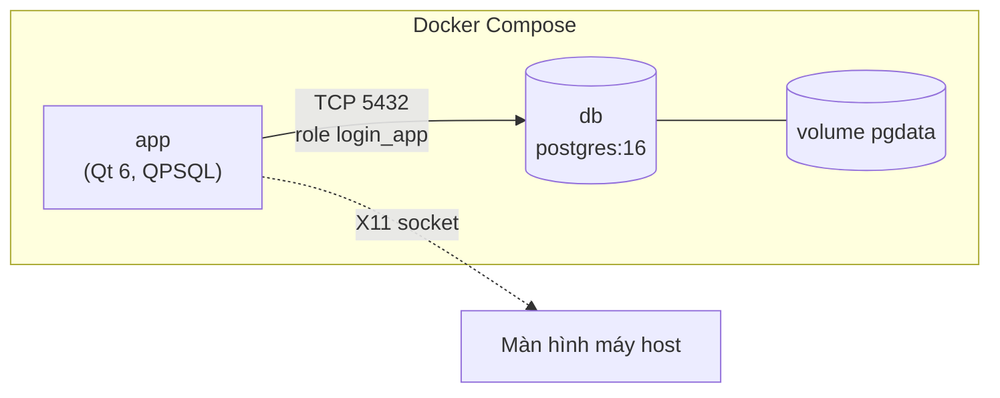

# Demo: ứng dụng Qt đăng nhập + PostgreSQL 16 + Docker

Ứng dụng desktop đơn giản (Qt 6 Widgets) cho phép **đăng nhập** và **tạo tài khoản**, dữ liệu lưu trong **PostgreSQL 16** chạy bằng Docker. Chỉ cần một lệnh:

```bash
./run.sh
```

Docker lo toàn bộ: tải PostgreSQL, build ứng dụng Qt, tạo database. **Không cần cài Qt, CMake hay trình biên dịch** trên máy bạn.

## Yêu cầu

| Hệ điều hành | Cần có |
| --- | --- |
| **Linux** (X11 hoặc Wayland có XWayland) | Docker Engine + plugin Compose v2, `bash`. Khuyến nghị cài thêm `xhost` (`x11-xserver-utils`). |
| **Windows** | WSL2 (Windows 11 có WSLg sẵn) + Docker Desktop (bật WSL integration). Chạy `./run.sh` **trong terminal WSL**. |
| **macOS** | Docker Desktop + [XQuartz](https://www.xquartz.org) (`brew install --cask xquartz`; mở XQuartz → Settings → Security → bật *Allow connections from network clients*; đăng xuất/đăng nhập lại). |

Tài khoản chạy Docker cần có quyền dùng Docker (Linux: `sudo usermod -aG docker $USER` rồi đăng nhập lại).

## Sử dụng

```bash
./run.sh          # build + khởi động DB + mở ứng dụng
./run.sh test     # kiểm thử tự động (không cần giao diện)
./run.sh psql     # mở psql vào database
./run.sh logs     # xem log PostgreSQL
./run.sh down     # dừng container, giữ dữ liệu
./run.sh reset    # dừng và XÓA dữ liệu + file .env
```

Lần chạy đầu mất vài phút (tải image, build). Các lần sau gần như tức thì nhờ cache.

**Tài khoản mẫu** (chỉ để demo): `admin / admin123` và `demo / demo123`. Bạn cũng có thể bấm **Create account** để tạo mới.

## Cách hoạt động



1. `run.sh` kiểm tra Docker, tạo `.env` với **mật khẩu ngẫu nhiên** (lần đầu), thiết lập quyền hiển thị X11.
2. `docker compose build app`: biên dịch ứng dụng trong image Ubuntu 24.04 (multi-stage, ảnh chạy chỉ chứa thư viện cần thiết).
3. `docker compose run app`: khởi động `db`, **chờ healthcheck** xong rồi mới chạy ứng dụng. Ứng dụng còn tự thử lại kết nối tối đa 30 giây.
4. Lần đầu volume còn trống, PostgreSQL tự chạy [`db/init.sh`](db/init.sh) → [`db/schema.sql`](db/schema.sql) để tạo bảng, dữ liệu mẫu và role ứng dụng.
5. Cửa sổ Qt hiển thị trên máy bạn qua X11 socket.

## Cấu trúc thư mục

```text
qt-postgres-login-demo/
├── run.sh                 # điểm vào duy nhất
├── docker-compose.yml     # db (postgres:16) + app (Qt)
├── Dockerfile             # multi-stage: build Qt -> image chạy gọn nhẹ
├── .env.example           # mẫu cấu hình (run.sh tự sinh .env)
├── db/
│   ├── init.sh            # chạy 1 lần khi khởi tạo DB, truyền mật khẩu vào schema.sql
│   └── schema.sql         # bảng app_users, dữ liệu mẫu, role login_app
└── app/
    ├── CMakeLists.txt
    └── src/
        ├── main.cpp           # khởi động, chế độ --selftest
        ├── AuthService.*      # toàn bộ truy cập DB (đăng nhập, đăng ký)
        ├── LoginWindow.*      # màn hình đăng nhập
        ├── RegisterDialog.*   # hộp thoại tạo tài khoản
        └── WelcomeWindow.*    # màn hình sau khi đăng nhập
```

## Thiết kế cơ sở dữ liệu

```sql
app_users(
  id bigint IDENTITY PK,
  username varchar(50) CHECK (^[A-Za-z0-9_.-]{3,50}$),   -- duy nhất, không phân biệt hoa/thường
  password_hash text NOT NULL,                             -- bcrypt
  full_name varchar(150),
  created_at timestamptz, last_login_at timestamptz
)
UNIQUE INDEX uq_app_users_username ON (lower(username))
```

Các điểm đáng chú ý (đều giải thích trong [../Database.md](../Database.md)):

- **Mật khẩu không lưu dạng rõ.** Dùng `pgcrypto`: `crypt(password, gen_salt('bf', 10))` khi đăng ký; khi đăng nhập so sánh `password_hash = crypt(:p, password_hash)`.
- **Chống SQL injection:** mọi truy vấn dùng bind parameter (`prepare` + `bindValue`). `./run.sh test` có ca thử `admin' OR '1'='1`.
- **Ít đặc quyền nhất:** ứng dụng kết nối bằng role `login_app`, chỉ có `SELECT`, `INSERT` trên `app_users` và `UPDATE (last_login_at)`. Không xóa được người dùng, không đổi được hash.
- **Index theo biểu thức** `lower(username)` vừa bảo đảm tính duy nhất không phân biệt hoa/thường, vừa giúp truy vấn đăng nhập dùng index.
- **Thông báo lỗi chung** "Invalid username or password" cho cả sai user lẫn sai mật khẩu, tránh lộ tài khoản có tồn tại hay không.
- **Cổng 5432 không publish ra host** theo mặc định, nên không đụng PostgreSQL sẵn có và DB không bị lộ ra mạng. Muốn truy cập từ host, bỏ comment dòng `ports` trong `docker-compose.yml`, hoặc dùng `./run.sh psql`.

## Cấu hình

Các biến trong `.env` (tự sinh lần đầu, có mẫu ở `.env.example`):

| Biến | Ý nghĩa |
| --- | --- |
| `POSTGRES_USER` / `POSTGRES_PASSWORD` | Superuser của PostgreSQL (chỉ dùng cho quản trị, ứng dụng không dùng). |
| `POSTGRES_DB` | Tên database (`appdb`). |
| `APP_DB_PASSWORD` | Mật khẩu của role `login_app` mà ứng dụng dùng. |

> Các biến này chỉ có hiệu lực **lần khởi tạo đầu** (khi volume `pgdata` còn trống). Muốn đổi, chạy `./run.sh reset` rồi `./run.sh`.

Ứng dụng đọc kết nối từ biến môi trường `DB_HOST`, `DB_PORT`, `DB_NAME`, `DB_USER`, `DB_PASSWORD` (do `docker-compose.yml` truyền vào).

## Xử lý sự cố

| Hiện tượng | Cách xử lý |
| --- | --- |
| `could not connect to display` / không thấy cửa sổ | Phải chạy trong phiên đồ họa có `$DISPLAY`. Linux: cài `xhost` (`sudo apt install x11-xserver-utils`). macOS: mở XQuartz và bật *network clients*. WSL: cần Windows 11/WSLg. |
| `permission denied ... docker.sock` | `sudo usermod -aG docker $USER`, đăng nhập lại. |
| `password authentication failed` | `.env` không khớp dữ liệu cũ. Chạy `./run.sh reset` rồi `./run.sh`. |
| Muốn xem dữ liệu | `./run.sh psql` rồi `SELECT id, username, last_login_at FROM app_users;` |
| Muốn build lại từ đầu | `docker compose build --no-cache app` |

## Mở rộng gợi ý

- Giới hạn số lần đăng nhập sai (cột `failed_attempts`, `locked_until`).
- Đổi mật khẩu, quên mật khẩu, phân quyền (`role` cho người dùng).
- Dùng migration (Flyway, Liquibase, sqitch) thay cho `schema.sql` khi schema thay đổi theo thời gian.
- Kết nối qua TLS khi DB nằm ở máy khác.
