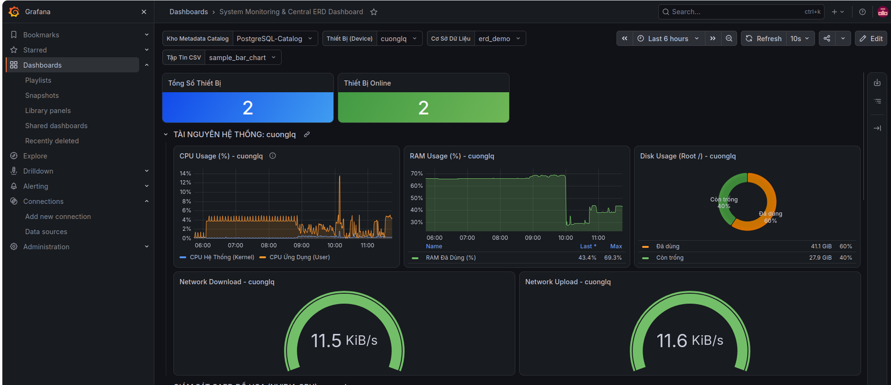
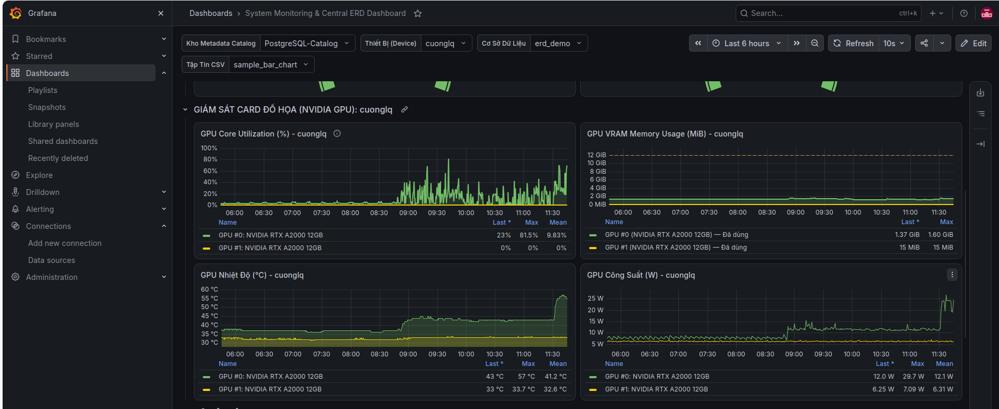
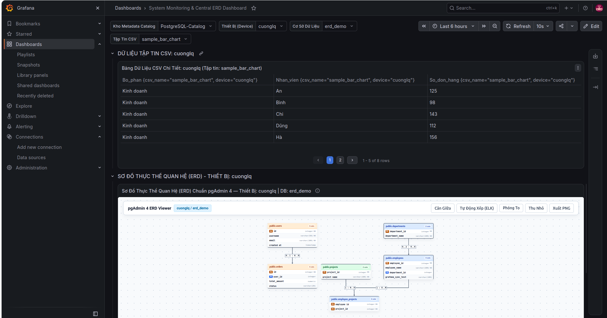
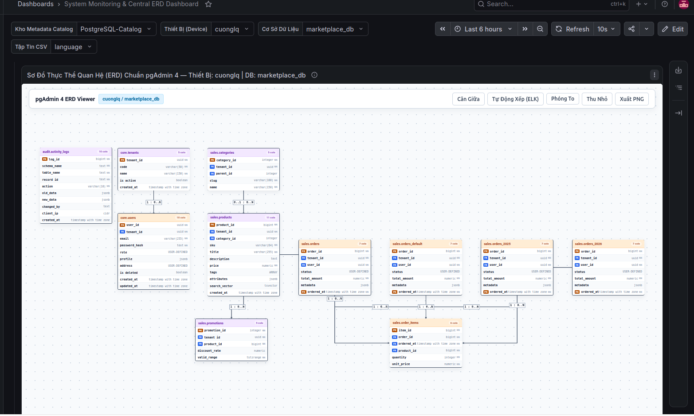

# Trung Tâm Quản Lý Hệ Thống Giám Sát & ERD Viewer

Hệ thống giám sát phân tán đa thiết bị (Máy chủ trung tâm Grafana + InfluxDB + Kho Metadata PostgreSQL + Dịch vụ vẽ ERD Cytoscape.js/ELK.js + Telegraf Agents).

---

## Cấu Trúc Dự Án

```text
grafana/
├── Script/
│   ├── May_A/                       ← Dành cho Máy Chủ Trung Tâm (Grafana, InfluxDB, Catalog, ERD)
│   │   ├── setup.sh                 ← Script cài đặt & chạy dịch vụ máy chủ trọn gói
│   │   ├── manage.py                ← Quản lý Dashboard Grafana & Đồng bộ Metadata ERD
│   │   ├── monitoring-dashboard.json← File cấu hình Dashboard Grafana hoàn chỉnh
│   │   ├── erd_service/             ← Dịch vụ ERD Viewer Microservice (Port 8088 qua systemd)
│   │   ├── configs/config.json      ← Cấu hình thông số máy chủ & tokens
│   │   └── sql/                     ← Script khởi tạo database monitoring_catalog
│   │
│   └── May_Khac/                    ← Dành cho các Máy Con / Thiết Bị Cần Giám Sát (Máy B, C...)
│       ├── install-agent-v2.sh      ← Script cài đặt Telegraf Agent tự động (GPU, CSV, PostgreSQL)
│       ├── device.yaml              ← File cấu hình mẫu cho máy con
│       ├── device.yaml.template     ← Template cấu hình sinh tự động
│       └── manage.py                ← Công cụ chạy cronjob đồng bộ metadata bảng lên máy chủ
│
├── doc/                             ← Trọn bộ tài liệu kỹ thuật
│   ├── README.md                    ← Tổng quan kiến trúc & các tính năng cốt lõi
│   ├── SETUP.md                     ← Hướng dẫn cài đặt Máy A và các máy con chi tiết từ A-Z
│   └── USAGE.md                     ← Cẩm nang vận hành, thêm CSV mới, tự động phát hiện DB
│
└── Other/                           ← Tệp dữ liệu mẫu & báo cáo dọn dẹp
    ├── sample_data/                 ← Các tệp CSV mẫu để kiểm tra tính năng vẽ biểu đồ
```

---

## Hướng Dẫn Nhanh (Quick Start)

### 1. Trên Máy Chủ Trung Tâm (Máy A)
```bash
cd Script/May_A
./setup.sh --central-server
```
* **Grafana Dashboard:** `http://localhost:3000/d/monitoring` hoặc `http://<IP_MAY_A>:3000/d/monitoring` (`admin` / `admin`)
* **ERD Viewer:** `http://localhost:8088` hoặc `http://<IP_MAY_A>:8088` (chạy ngầm qua `erd-viewer.service`)

### 2. Trên Máy Con Cần Giám Sát (Máy B, Máy C...)
1. Copy thư mục `Script/May_Khac` sang máy con.
2. Mở file `device.yaml`, điền ID máy và kiểm tra IP Máy A.
3. Chạy cài đặt:
   ```bash
   sudo -E ./install-agent-v2.sh --config device.yaml
   ```

Sau khi hoan thanh





---

## Xem Tài Liệu Chi Tiết

* [Hướng dẫn cài đặt chi tiết (doc/SETUP.md)](doc/SETUP.md)
* [Cẩm nang vận hành & xử lý sự cố (doc/USAGE.md)](doc/USAGE.md)
* [Kiến trúc & tính năng tổng thể (doc/README.md)](doc/README.md)
* [Báo cáo phân loại tệp phụ trợ (Other/README.md)](Other/README.md)
