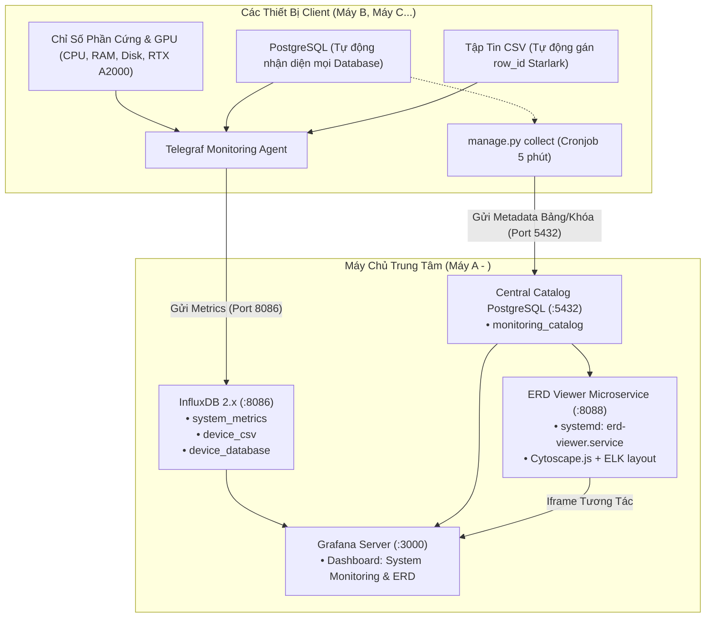

# Hệ Thống Giám Sát Phân Tán & Sơ Đồ Thực Thể Quan Hệ (ERD)

Hệ thống giám sát tài nguyên phần cứng, dịch vụ hệ thống, cơ sở dữ liệu PostgreSQL và dữ liệu bảng CSV phân tán với máy chủ trung tâm hiển thị trực quan trên Grafana kết hợp sơ đồ ERD tương tác chuẩn pgAdmin 4 (Cytoscape.js + ELK.js).

---

## Kiến Trúc Hệ Thống



---

## Cấu Trúc Thư Mục Chuẩn Hóa

Hệ thống được tổ chức khoa học thành các thư mục chức năng:

```text
grafana/
├── Script/
│   ├── May_A/                       ← Dành riêng cho Máy Chủ Trung Tâm
│   │   ├── setup.sh                 ← Script cài đặt trọn gói máy chủ từ A-Z
│   │   ├── manage.py                ← Quản trị CLI: sinh dashboard, import Grafana, đồng bộ ERD
│   │   ├── monitoring-dashboard.json← File cấu hình Dashboard JSON chuẩn
│   │   ├── configs/
│   │   │   └── config.json          ← Token InfluxDB, tài khoản Grafana, cấu hình Catalog
│   │   ├── erd_service/             ← Microservice ERD Cytoscape.js + ELK.js (port 8088)
│   │   │   ├── server.py
│   │   │   └── public/ (index.html, cytoscape.min.js, elk.bundled.js...)
│   │   └── sql/
│   │       └── init_central_catalog.sql ← Schema cơ sở dữ liệu monitoring_catalog
│   │
│   └── May_Khac/                    ← Đóng gói mang sang các máy client (Máy B, C...)
│       ├── install-agent-v2.sh      ← Script cài đặt Agent Telegraf tự động
│       ├── device.yaml              ← Cấu hình Agent hoàn chỉnh cho thiết bị
│       ├── device.yaml.template     ← Template cấu hình sinh tự động
│       └── manage.py                ← CLI Python phục vụ cronjob đồng bộ metadata ERD
│
├── doc/                             ← Trọn bộ tài liệu kỹ thuật
│   ├── README.md                    ← Tổng quan kiến trúc & các tính năng cốt lõi
│   ├── SETUP.md                     ← Hướng dẫn cài đặt Máy A và các máy con
│   └── USAGE.md                     ← Cẩm nang vận hành, cấu hình CSV, PostgreSQL, ERD
│
└── Other/                           ← Tệp dữ liệu mẫu & báo cáo dọn dẹp
    ├── sample_data/
    │   ├── sample_bar_chart.csv     ← Dữ liệu số mẫu để kiểm tra vẽ biểu đồ
    │   └── sample_language.csv      ← Dữ liệu chuỗi mẫu kiểm tra bảng dữ liệu
    └── README.md                    ← Báo cáo kiểm kê và phân loại tệp phụ trợ
```

---

## Các Tính Năng Nổi Bật

1. **Tự động nhận diện Database (PostgreSQL Auto-discovery):**
   * Chỉ cần khai báo `databases: ["auto"]`, agent sẽ tự động quét toàn bộ cơ sở dữ liệu người dùng trên máy.
   * Telegraf tự giám sát hiệu năng cho từng DB.
   * Kho Metadata tự động bóc tách cấu trúc bảng, kiểu dữ liệu, khóa chính (PK) và khóa ngoại (FK) để vẽ ERD.

2. **Giám sát CSV thông minh & Tổng quát (Universal CSV Indexer):**
   * Cấu hình dạng thư mục `paths: ["/path/*.csv"]`, khi thả bất kỳ file CSV mới nào vào thư mục hệ thống sẽ tự động giám sát.
   * Sử dụng Telegraf Starlark processor tự động đánh chỉ mục `row_id` duy nhất cho từng dòng, giải quyết triệt để lỗi ghi đè dữ liệu của InfluxDB và ngăn chặn việc lặp dòng theo phút trên Grafana.
   * Không phụ thuộc vào tên cột cụ thể, hoạt động với mọi định dạng CSV trên mọi máy Ubuntu.

3. **Sơ đồ ERD tương tác chuẩn pgAdmin 4:**
   * Tự động sắp xếp node và dây liên kết khóa ngoại bằng thuật toán ELK (Eclipse Layout Kernel).
   * Chạy dạng service nền systemd (`erd-viewer.service`) trên cổng 8088, tự khởi động cùng hệ điều hành.

4. **Tự động phát hiện GPU NVIDIA:**
   * Tự động kiểm tra lệnh `nvidia-smi` để kích hoạt bảng theo dõi nhiệt độ (°C), công suất tiêu thụ (W) và mức chiếm dụng VRAM.
