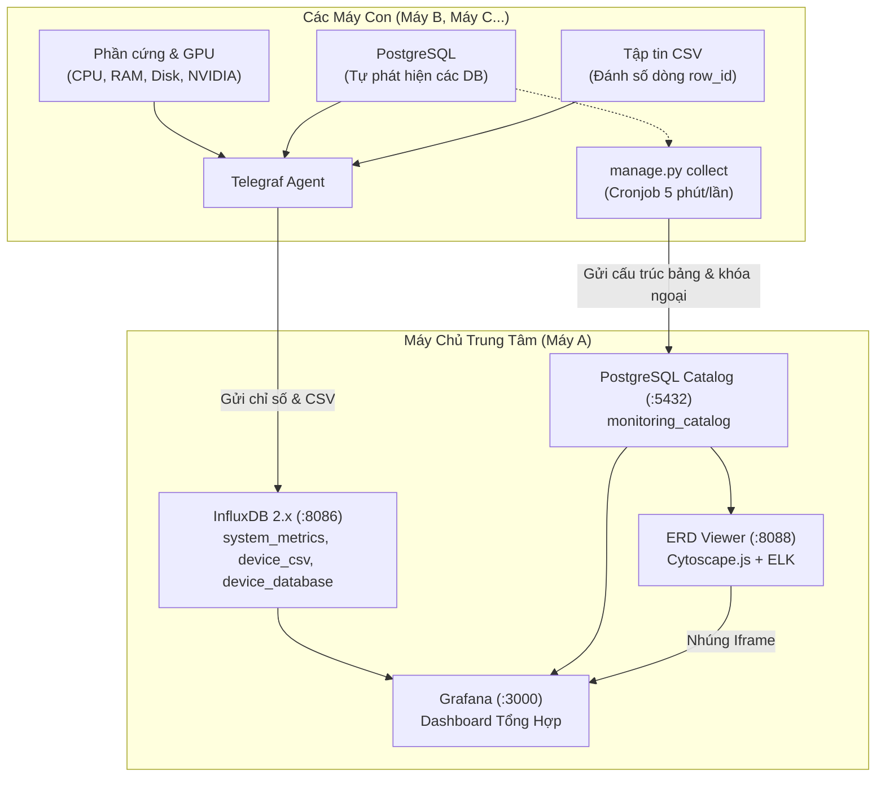

# Tổng Quan Hệ Thống Giám Sát & Sơ Đồ ERD

Hệ thống thu thập chỉ số phần cứng, dịch vụ, dữ liệu CSV và cấu trúc cơ sở dữ liệu PostgreSQL từ nhiều máy con về một **Máy Chủ Trung Tâm (Máy A)** để hiển thị trực quan trên Grafana, kèm công cụ vẽ sơ đồ quan hệ ERD tương tác.

---

## 1. Luồng Hoạt Động & Kiến Trúc



---

## 2. Vai Trò Từng Thành Phần Chính

| Thành phần | Chạy ở đâu? | Nhiệm vụ chính |
| :--- | :---: | :--- |
| **Telegraf** | Máy con | Thu thập định kỳ chỉ số CPU, RAM, Disk, Network, GPU, PostgreSQL và đọc nội dung file CSV gửi về InfluxDB. |
| **`manage.py collect`** | Máy con | Quét cấu trúc bảng, cột, khóa chính/khóa ngoại của PostgreSQL gửi về `monitoring_catalog` mỗi 5 phút. |
| **InfluxDB 2.x** | Máy A (`:8086`) | Lưu trữ dữ liệu chuỗi thời gian (metrics hệ thống) và nội dung bảng CSV. |
| **PostgreSQL Catalog** | Máy A (`:5432`) | Lưu trữ metadata cấu trúc bảng và quan hệ khóa ngoại của tất cả các máy. |
| **ERD Viewer (`server.py`)** | Máy A (`:8088`) | Dịch vụ web vẽ sơ đồ ERD tương tác (Cytoscape + ELK) và hỗ trợ xuất ảnh PNG. |
| **Grafana** | Máy A (`:3000`) | Giao diện web hiển thị toàn bộ biểu đồ, bảng CSV và nhúng khung sơ đồ ERD. |

---

## 3. Cấu Trúc Thư Mục & Tài Liệu

```text
grafana/
├── Script/
│   ├── May_A/                       # Script cài đặt, service ERD, SQL và Dashboard JSON cho Máy A
│   └── May_Khac/                    # Gói cài Agent (install-agent-v2.sh, device.yaml, manage.py) cho Máy con
├── Other/sample_data/               # File CSV mẫu để thử nghiệm bảng và biểu đồ
└── doc/                             # Bộ tài liệu hướng dẫn
    ├── README.md                    # Tổng quan kiến trúc (file này)
    ├── SETUP.md                     # Hướng dẫn cài đặt chi tiết và mục đích từng gói cài
    ├── USAGE.md                     # Cách thêm CSV, chuyển đổi biểu đồ, đồng bộ ERD & xử lý lỗi
    └── MANUAL_DASHBOARD.md          # Hướng dẫn tự tạo Dashboard thủ công & giải thích câu Query
```

**Thứ tự đọc gợi ý:** Đọc [SETUP.md](SETUP.md) để cài đặt hệ thống → xem [USAGE.md](USAGE.md) để vận hành hàng ngày → xem [MANUAL_DASHBOARD.md](MANUAL_DASHBOARD.md) nếu muốn tự dựng hoặc tùy biến biểu đồ Grafana.


